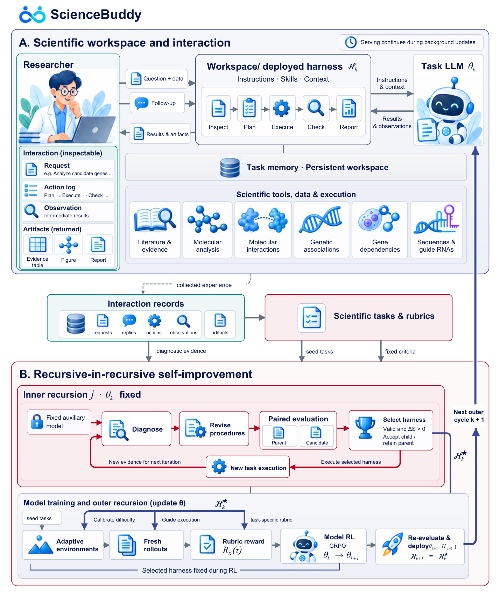

# ScienceBuddy: Recursive-in-Recursive Self-Improvement for Interactive Scientific Agents

> PhAI Labs / Fudan University Zhongshan Hospital / Shanghai Academy of Natural Sciences / Shunwei Capital / University of Oxford 等 · 2026-09-15 · paper · **闭环** · [论文](https://arxiv.org/abs/2609.17523) · [仓库](https://github.com/Gen-Verse/ScienceBuddy)
> 机制族：AI 科学家系统 · 来源核验 2026-09-18 · 复现状态 not-run

## Pipeline

交互式科研工作台耦合两个递归：内层固定模型，由固定辅助模型（GPT-6 Astra）每次提出一个有界 harness 编辑（指令、技能或上下文设置），仅在 schema 合法且配对开发评测优于父代时接受；外层在冻结的改进 harness 下用从完整协作轨迹合成的评分表奖励做 GRPO 训练任务模型。研究者反馈定义评分标准，但本身不充当训练奖励。

*图源：Figure 2 (S0.F2, system diagram)*
## 结果（作者报告，非本地复现）

四个科研任务族（来自 LAB-Bench 与 Biomni-Eval1 的 895 个任务）。耦合三轮实验：测试准确率 42.2%→73.3%，33.3% 问题由错转对、2.2% 退化。仅 harness（模型固定）：验证准确率 31.1%→51.1%（+20 点）。仅模型（harness 固定）：约两小时 RL 后 pass@4 覆盖 48.3%→67.8%。

## 证据边界

附录明确单项技能与反馈来源的贡献未单独隔离；辅助反思器固定，任务表现变好不代表改进机制本身变强；未给 token 成本核算。

## 对 nanoRSI 的输入

对 nanoRSI：让有界 harness 编辑（仅配对评测提升才接受）与冻结胜者下的模型训练阶段交替——两个递归互相喂养，但绝不同时改动同一个面。

## 来源

[arXiv abstract](https://arxiv.org/abs/2609.17523) · [arXiv HTML v1](https://arxiv.org/html/2609.17523v1) · [GitHub repository](https://github.com/Gen-Verse/ScienceBuddy)
