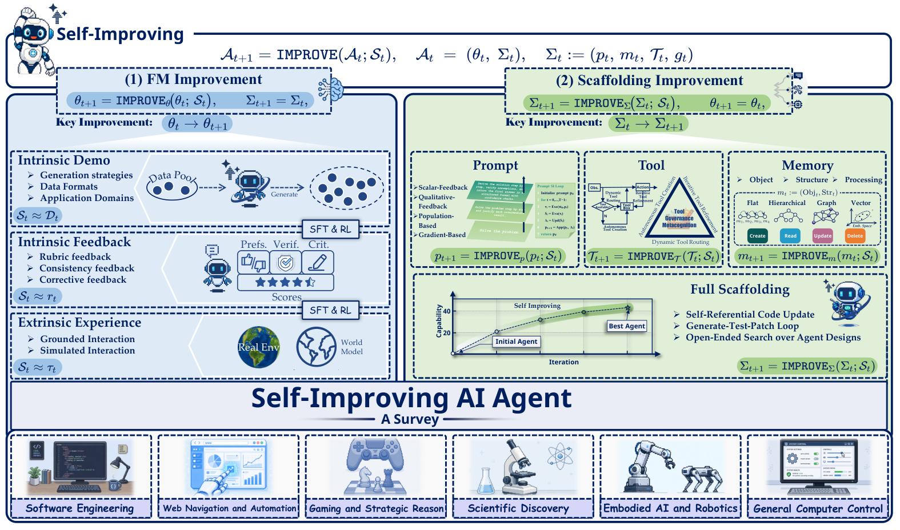

# Self-Improvements in Modern Agentic Systems: A Survey

> Jilin University / KAUST / University of Alberta / IDSIA/USI/SUPSI · 2026-07-14 · paper · **支撑·无闭环** · [论文](https://arxiv.org/abs/2607.13104) · [仓库](https://github.com/selfimproving-agent/awesome-Self-Improving-Agents)
> 机制族：分析与审计 · 来源核验 2026-09-16 · 复现状态 not-run

## Pipeline

97 页综述，把自改进形式化为作用于智能体状态 (theta, Sigma) 的自诱导更新算子 A(t+1) = U(A(1:t), E(...))，其中脚手架 Sigma =（提示、记忆、工具、控制逻辑）；两条组织轴是更新目标（基础模型参数 vs 脚手架组件）与改进信号来源（内在生成演示、内在评价反馈、外在探索经验）。

*图源：Figure 1*
## 结果（作者报告，非本地复现）

无基准；贡献为统一分类（基础模型更新 vs 脚手架更新）、信号来源分类、策划的 awesome 清单，以及设计启示：分层闸门保安全、把评论家当作受治理的基础设施、快探索配慢巩固。

## 证据边界

综述：无实验；分类法是作者的综合。其'更新算子'形式化与本资料库的四个改变面接近，故按 enabling 收录。

## 对 nanoRSI 的输入

对 nanoRSI：采纳'信号来源'轴（内在生成/内在评价/外在经验）作为标注候选变更的必填字段——它决定了哪种验收闸门是可行的。

## 来源

[arXiv abstract](https://arxiv.org/abs/2607.13104) · [Paper v1 (affiliations, Figures 1/3, formalism)](https://arxiv.org/html/2607.13104v1) · [Awesome list](https://github.com/selfimproving-agent/awesome-Self-Improving-Agents)
