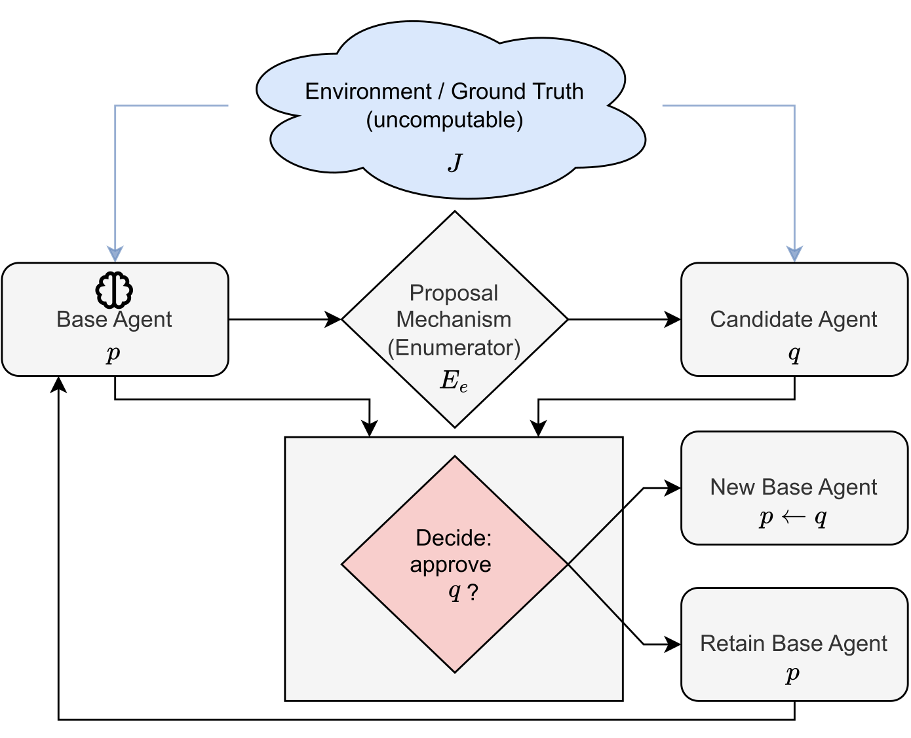

# The Self-Improvement Problem

> German Research Center for Artificial Intelligence (DFKI) / RPTU Kaiserslautern-Landau · 2026-10-15 · paper · **闭环** · [论文](https://arxiv.org/abs/2610.21646) · [仓库](https://github.com/Brian-Moser/SelfImprovementProof)
> 机制族：分析与审计 · 来源核验 2026-10-17 · 复现状态 not-run

## Pipeline

把安全自改进形式化：智能体是程序、改进是未必可计算的语义分数，而任何自动闸门（奖励模型、回归测试套件、自动评审）都必须是可终止的可计算过程。研究两种评估抽象——批准/拒绝更新的证明器（certifier）与在给定提案生成器下输出改进候选的搜索过程。定理：在完全一般的设定下，不存在可同时保证可靠性（绝不接受非改进）与非保守性（绝不放过可得改进）的可终止过程；自指构造可迫使任何此类闸门或搜索器失败，有界误差的随机化闸门同样受限。在有界评估、有限提案预算的机制下，穷举模拟给出具备期望保证的可终止搜索——但被接受的更新链可以每轮都抬高有界分数而真实分数下降。

*图源：Figure 1 (SelfImprovementProblem.svg), arXiv HTML 2610.21646v1*
## 结果（作者报告，非本地复现）

无实验（理论）。结论：无界通用设定下不可能；有界设定下可按设计恢复保证；并给出恢复极限（有界分数逐轮上升而真实分数下降）——划出“正确性保证崩溃”与“可工程恢复”的边界。

## 证据边界

纯理论、采用风格化抽象（语义分数、无界行为）；实用系统本就生活在论文自己恢复的有界机制内，因此不可能性是边界陈述而非末日论——作者亦如此表述。本次核验未检查其证明代码。

## 对 nanoRSI 的输入

这是 nanoRSI 闸门教义的理论支柱：冻结面板、有限提案预算与有界评测器正是保证得以恢复的可判定机制——而“有界分数升、真实分数降”的极限，正是反事实面板与留出 freeze/final-test 存在理由的形式化表述。今后凡触及闸门的 ADOPTION 条目都应引用这条边界。

## 来源

[arXiv abs 2610.21646](https://arxiv.org/abs/2610.21646) · [SelfImprovementProof code](https://github.com/Brian-Moser/SelfImprovementProof)
