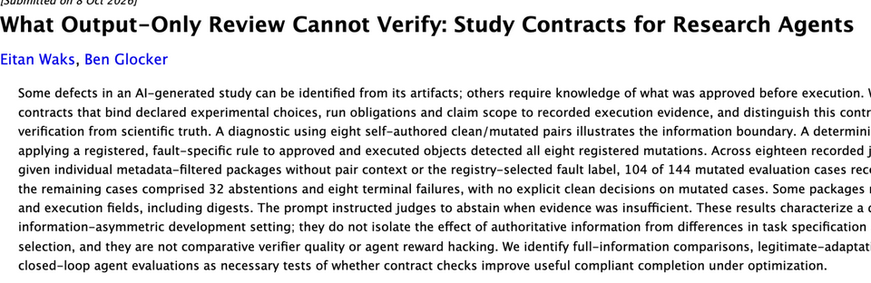

# What Output-Only Review Cannot Verify: Study Contracts for Research Agents

> Imperial College London · 2026-10-08 · paper · **支撑·无闭环** · [论文](https://arxiv.org/abs/2610.11754)
> 机制族：分析与审计 · 来源核验 2026-10-12 · 复现状态 not-run

## Pipeline

研究契约把输出评审看不到的三样东西——声明的实验选择、运行义务、声明范围——绑定到留存的执行证据，并把这种'相对契约的验证'与科学真理区分开。确定性检查器对已批准与已执行对象施加一条注册的、针对特定故障的规则；诊断刻意对评审者隐去配对上下文与注册表选定的故障标签，以量测'仅看产物'与'基于契约'评审之间的信息边界。

*图源：arXiv abstract page, title/authors/v1-date/abstract crop (2026-10-12); the preprint prints no figures*
## 结果（作者报告，非本地复现）

在八对自制的干净/变异研究上，施加注册故障规则的确定性检查器检出全部八处注册变异。十八个有记录的评审者别名各拿到经元数据过滤的包（无配对上下文、无故障标签），144 个变异评测案例中 104 个收到缺陷标记，32 次弃权、8 次终端失败，对变异案例无显式判净。部分包保留了含摘要在内的批准与执行字段。

## 证据边界

作者自述结果刻画的是刻意信息不对称的开发环境，未把权威信息的影响与任务设定及规则选择的差异分离，也未比较验证器质量或智能体奖励作弊；全文信息对照、合法适配控制与闭环智能体评测被列为必要的后续检验。变异集为自造；预印本未附公开代码或数据。

## 对 nanoRSI 的输入

该思路与 nanoRSI 证据账本一一对应：在承认一项声称的改进前，把声明的选择、运行义务与声明范围绑定到留存的执行证据，并把'对契约可验'当作不同于'为真'的属性——具体做法是对已批准与已执行对象按摘要闸门，并以隐去标签条件下的评审决策作为诚实性探针。

## 来源

[arXiv abstract](https://arxiv.org/abs/2610.11754) · [arXiv HTML v1](https://arxiv.org/html/2610.11754v1)
