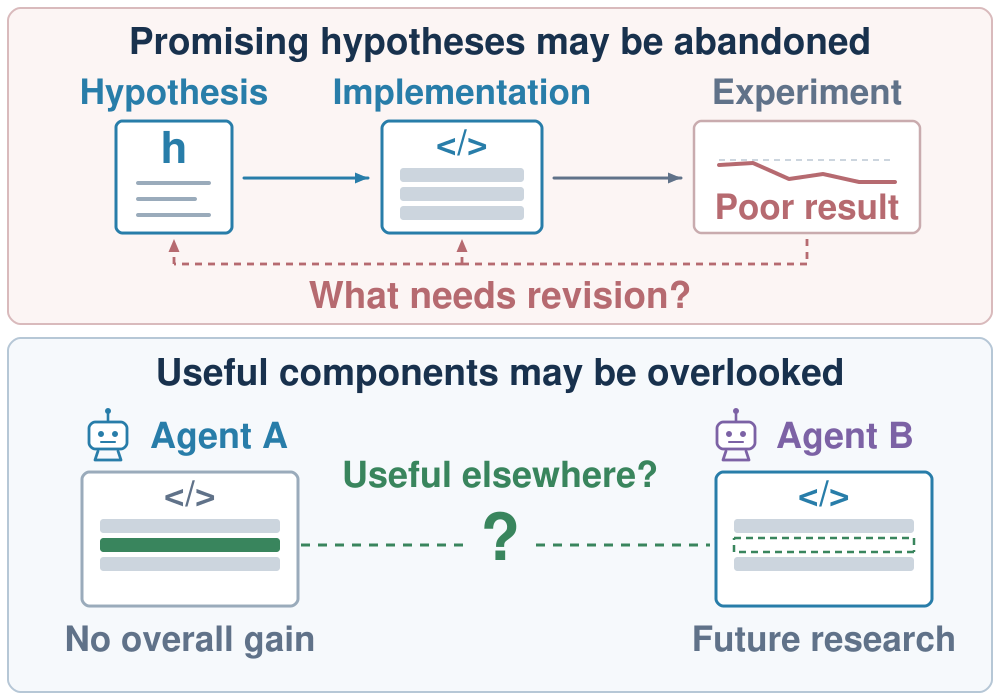

# SwarmRSI: Recursive Self-Improvement through Evolving Scientific Agent Swarm

> Huawei Technologies / Leiden University / University of Groningen · 2026-10-14 · paper · **闭环** · [论文](https://arxiv.org/abs/2610.20431)
> 机制族：AI 科学家系统 · 来源核验 2026-10-17 · 复现状态 not-run

## Pipeline

演化科研智能体群体，使一个智能体的发现与实现能推进另一个智能体的研究。反馈引导群体变异用其他智能体的实验反馈同时精修假设及其实现（解决“结果差该改假设还是改实现”的归因歧义）；互补群体重组跨智能体复用被保留的假设与互补的程序组件，让部分成果支撑新研究而非被总体程序分数淹没；递归群体演化把每次结果写回共享图，指导每个智能体下一步更新哪个状态。

*图源：Figure 1 (figure1_swarmrsi.svg), arXiv HTML 2610.20431v1*
## 结果（作者报告，非本地复现）

在 OpenProblems 与 NatureBench 上 SOTA：Gemini 3.1 Pro Preview 下 OpenProblems 平均分 76.2，NatureBench 上 44.4% 任务追平已发表 SOTA（对比方法中最高的 Match-SOTA 率）；MLE-Bench Lite 上 81.8% 任务获奖牌，高于同骨干的假设演化与程序演化智能体。共 118 个科研编码与机器学习工程任务、两个骨干（Gemini 3.1 Pro Preview、DeepSeek-V4-Pro）。

## 证据边界

HTML 全文未找到代码或仓库链接；许可 CC BY-NC-SA 4.0（非商业——只借鉴思想、不复用代码）。SOTA 声明为作者自跑对比（含附录 B.2 的同骨干重跑）；本次核验覆盖摘要/引言声明与作者块，未重推全部结果表格。逐作者机构映射不完整（以集合渲染）。

## 对 nanoRSI 的输入

跨智能体互补组件复用是 nanoRSI 种群模式缺的模式：按组件验证把关的候选级部分程序合并是选择器研究的一个具体臂；“改假设还是改实现”的归因问题则对应我们失败尝试中“提案问题还是评测问题”的归因。

## 来源

[arXiv abs 2610.20431](https://arxiv.org/abs/2610.20431) · [HTML full text v1](https://arxiv.org/html/2610.20431v1)
