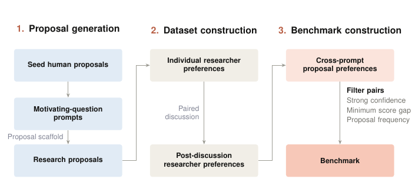

# TASTE: Can AI Models Judge AI Safety Research Proposals?

> Anthropic / Anthropic Fellows Program · 2026-08-28 · paper · **支撑·无闭环** · [论文](https://alignment.anthropic.com/2026/taste/)
> 机制族：对齐自动化 · 来源核验 2026-09-13 · 复现状态 not-run

## Pipeline

用专家偏好标签衡量模型选择研究提案的能力；这是改进控制器的一项潜在评测组件，不更新 Agent 或模型参数。

*图源：Figure 2, PDF p.3*
## 结果（作者报告，非本地复现）

在筛选出的 92 对提案上，报告最佳模型与标签一致率为 60%，估计人类一致率为 77%；模型区间宽度约为 ±10 个百分点。

## 证据边界

偏好集规模小且经过筛选；偏好一致不等于实际研究影响，人类一致率也来自特定标注协议的估计。

## 对 nanoRSI 的输入

可把提案选择能力与实验执行能力分别评测，并保留不确定或并列判断。

## 来源

[Official report](https://alignment.anthropic.com/2026/taste/) · [Paper](https://www-cdn.anthropic.com/files/4zrzovbb/website/dd5feddcb3b7d20aadda6af4093ac1fb0c9d419e.pdf)
