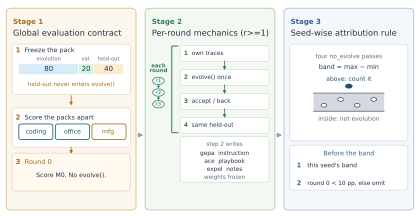

# Trace Evolution Bench: Measuring Whether Agents Improve from Their Own Environment Traces

> MatrixOrigin · 2026-10-10 · paper · **支撑·无闭环** · [论文](https://arxiv.org/abs/2610.15055)
> 机制族：分析与审计 · 来源核验 2026-10-15 · 复现状态 not-run

## Pipeline

这是测量协议而非新改进器：三套冻结的 80/20/40 任务包（办公、编码、制造；各 n=40 留出），锁定的留出 id 永不进入 evolve()，带接受/回滚的验证闸（min_delta=0），温度 0 下 R=3 轮；关键是对同一种子重复冻结重评 no_evolve，得到该种子自己的噪声带（四遍冻结通过的最大-最小）。真实改进判定为种子配对超额（方法增益减同种子 no_evolve 增益）超过该种子自身噪声带，并配反泄漏 id 检查、污染标记与 10pp 的第 0 轮配对门槛。

*图源：Pipeline figure (fig_teb_pipeline.svg): the rounds contract - round 0 scores M0 on locked held-out ids and freezes the baseline; rounds 1-3 each run evolve() once, accept or roll back via the validation gate, then rescore the same ids, with excess read against the seed's four-pass no_evolve band*
## 结果（作者报告，非本地复现）

编码赛道（主记分板）：DeepSeek 文本更新 9 格中 7 格超过自身种子带（gepa_llm 种子 42/43 各 +15.0；ace_llm 42/43 +20.0/+10.0；expel_llm 42/43/44 +15.0/+7.5/+20.0）；gepa_llm 种子 44 按自身 12.5pp 全带下行。不可复现是头条：GLM 仅 2 格超带、MiniMax 仅 1 格——没有任何方法在三模型全部种子上都稳超自身带。DeepSeek 编码三个种子的冻结 no_evolve 增益全为负（-7.5/-2.5/-10.0）：只看端点增益会高估进步。办公（带宽至 17.5pp）与制造赛道无超噪声的配对正超额。

## 证据边界

基准测的是文本更新管线（GEPA/ACE/ExpeL 式）在三套任务包上的表现，托管端点即便温度 0 也非确定；噪声带是种子特定的四遍最大-最小，不是置信区间；协议本身即贡献——不含新改进机制。

## 对 nanoRSI 的输入

TEB 用更锋利的工具外部验证了 nanoRSI 的噪声带纪律：种子配对超额对自身四遍带正是 ADOPTION 第 38/39 项规定的接受门槛；其 no_evolve 负增益（冻结重评会漂移下行）警示任何冻结面板比较都必须同场重测父代。'没有任何方法在每种子/模型上稳超自身带'的不可复现发现，就是已发布的 ADOPTION 第 37 项 ALFWorld flash 未复现在全领域的镜像。

## 来源

[arXiv abstract](https://arxiv.org/abs/2610.15055) · [arXiv HTML v1](https://arxiv.org/html/2610.15055v1)
