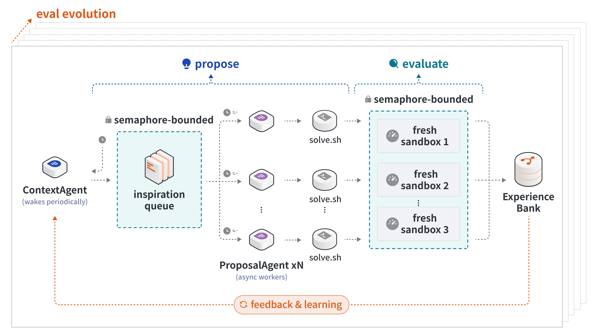

# Hyra: 简单有效的科学发现智能体

> Tencent Hunyuan · 2026-07-21 · report · **闭环** · [论文](https://hy.tencent.com/research/hyra) · [仓库](https://github.com/Tencent-Hunyuan/Hyra-results)
> 机制族：AI 科学家系统 · 来源核验 2026-09-19 · 复现状态 not-run

## Pipeline

生产者-消费者研究循环：Context Agent 维护经验库并持续把多样化灵感上下文入队；多个 Proposal Agent 撰写沙盒化方案（solve.sh 入口），在全新沙盒运行打分后回流经验库；无评估器时升级为双层循环、改进评估器本身（评估-方案共同进化）。

*图源：Hyra Harness loop diagram*
## 结果（作者报告，非本地复现）

复用 Recursive 公开设置：NanoChat Autoresearch 验证 BPB 0.9015 vs 0.9109；NanoGPT Speedrun 达 3.28 loss 用时 76.4s vs 77.5s；SOL-ExecBench 平均 SOL 0.771 vs 0.754（本地运行、Evaluation Stack v1.0）。另在 55 个数学开放问题上刷新 29 个；如实给出 reward-hacking 观察（NanoChat 泄漏未来 token、SOL-ExecBench 计时阶段缓存输出），并以此论证评估器需共同进化。

## 证据边界

公司博客报告，无论文；对 Recursive 的对比数字为复用公开设置的自跑结果；工件仓库为非标准自定义许可证；太阳黑子/药物设计结论属初步模拟。

## 对 nanoRSI 的输入

可移植的是评估器升级环：当严格闸门开始放过刷指标的候选时，先花一轮改进评估器（更严检查、更粗粒度奖励、更大进步空间），再继续候选搜索。

## 来源

[Official research page](https://hy.tencent.com/research/hyra) · [Artifacts repository](https://github.com/Tencent-Hunyuan/Hyra-results)
