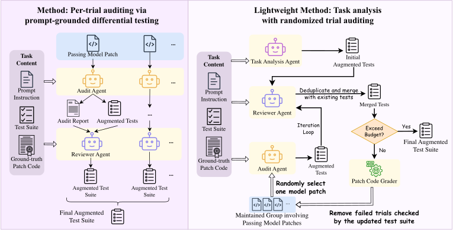

# TestJack: Should you trust the results in coding benchmarks? Agentic Coding Benchmarks Auditing via Evaluator Evolution

> Columbia University / University of California, Berkeley / George Mason University · 2026-10-07 · paper · **支撑·无闭环** · [论文](https://arxiv.org/abs/2610.10619)
> 机制族：分析与审计 · 来源核验 2026-10-13 · 复现状态 not-run

## Pipeline

不是在任何尝试之前一次性加固基准，而是逐次尝试动态审计：针对补丁可能违反的提示要求生成测试，仅保留真值补丁能通过的测试，并对失败复核，使每个确认的失败都有可重放的测试背书。轻量变体只深审随机抽样的尝试，再把所得测试复用到该任务全部尝试上。

*图源：Figure 3 (method_fig.svg): per-trial auditing via prompt-grounded differential testing, and the randomized lightweight auditing loop*
## 结果（作者报告，非本地复现）

对五个基准、六个前沿后端共 8,862 次尝试中 4,487 次基准判过的尝试做审计，驳回 1,545 次（34.4%）违反任务要求，使总体解决率从 50.6% 降到 33.2%（逐基准驳回率：DeepSWE 43.5%、SkillsBench 18.2%、SWE-Marathon 53.6%、SWE-bench Verified 7.6%、SWE-bench Pro 29.2%）。轻量变体以 15.4% 成本达到 72.4% 驳回复现率（较全量审计省约 4,037 美元，精确率约 49.2%），在相近精确率下相对 SWE-ABS 有 7.3 倍复现率优势；仅做任务分析只得 13.4% 复现率。

## 证据边界

假设任务良构（三类违规被排除）；轻量采样在有限预算下可能漏掉从未被抽样尝试里的缺陷；共享见证测试跨不同失败模式迁移差，均匀采样在干净任务上浪费预算；精确率偏低部分源于提示欠规范；排除需要 GPU 与超长时程任务。

## 对 nanoRSI 的输入

直接喂给 nanoRSI 评测器完整性：在 coding 轨为冻结面板生成以任务要求为锚的测试，且测试必须先通过参考实现才准入；让每个被拒候选都有可重放测试背书——把闸门的误拦率从假设变成可审计。先抽样后复用的变体与 nanoRSI 的 episode 预算约束相合。

## 来源

[arXiv abstract](https://arxiv.org/abs/2610.10619) · [arXiv HTML v1](https://arxiv.org/html/2610.10619v1)
