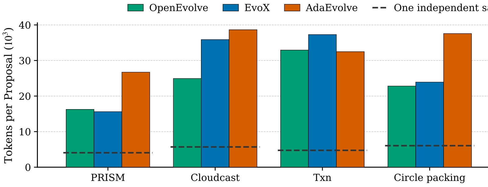

# LLM Evolutionary Search Strategies Should be Compared by Tokens

> IBM Research · 2026-10-20 · paper · **支撑·无闭环** · [论文](https://arxiv.org/abs/2610.23977)
> 机制族：分析与审计 · 来源核验 2026-10-21 · 复现状态 not-run

## Pipeline

对 LLM 演化式代码搜索的度量标准审计。重放 5 个任务、3 种方法的 600 份日志（研究对象含 OpenEvolve），指出提案计数掩盖真实成本：每提案 token 从 16k 到 39k 不等，等提案比较等于悄悄给某些方法 1.9 倍算力、给演化约 6 倍于独立采样的预算。改为等 token 预算（采样获得六倍尝试次数）并移除评分器漏洞后重比。

*图源：Figure 1 (cost_bars.svg), arXiv HTML 2610.23977v1, rendered to PNG*
## 结果（作者报告，非本地复现）

等 token 下演化优势基本消失：15 个任务-方法对中 12 对演化对独立采样的优势不超过 5%，仅 3 对保留 23-28% 优势且全在同一任务（Heilbronn）；Claude Haiku 4.5 复现了这一分化，第三个骨干显示优势幅度还依赖模型。报告 token 而非提案零成本修复记账——日志里本来就有。

## 证据边界

重放覆盖三种方法在五个任务的日志；评分器漏洞的移除属任务特定的工程处理；审计度量搜索效率，不回答演化是否找到性质不同的解。

## 对 nanoRSI 的输入

直接约束本仓库证据账本：逐候选记录 token 成本，一切选择器/闸门比较按等 token 预算执行（绝不按等尝试数）——token 列已存在，这是报告与协议修正而非新机制。

## 来源

[arXiv abs 2610.23977](https://arxiv.org/abs/2610.23977) · [arXiv HTML v1](https://arxiv.org/html/2610.23977v1)
