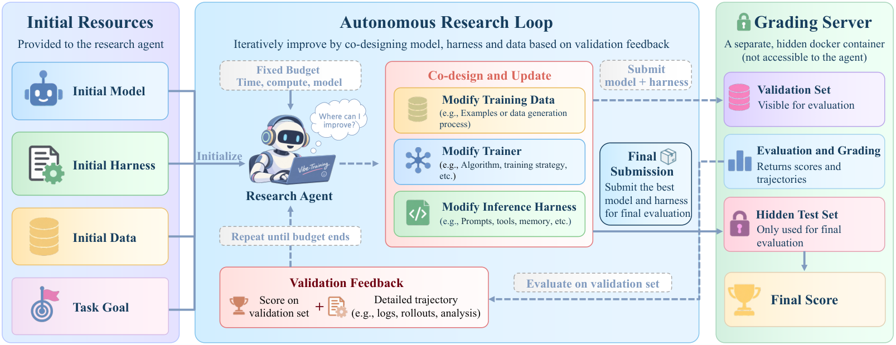

# VibeTraining-Bench: Data-Trainer-Harness Co-Design for Iterative System Improvement

> Zhejiang University / Westlake University / Alibaba Group (Token Hub) / South China University of Technology / The Chinese University of Hong Kong · 2026-10-20 · paper · **闭环** · [论文](https://arxiv.org/abs/2610.26342) · [仓库](https://github.com/D2I-ai/VibeTraining-Bench)
> 机制族：自主后训练及其评测 · 来源核验 2026-10-21 · 复现状态 not-run

## Pipeline

一个评测作者所称跨组件协同设计（cross-component co-design）RSI 能力的基准：研究智能体在同一初始智能体系统、固定资源预算下出发，在验证反馈引导下迭代改进训练数据、训练器与推理 harness，最终选定并提交一个系统做隐藏测试集评估。强制三重防奖励作弊保障：测试数据隔离、研究与判分容器分离、研究智能体断网。

*图源：Figure 1 (VibeTrain-Bench_Main_Figure2.png), arXiv HTML 2610.26342v1*
## 结果（作者报告，非本地复现）

前沿研究智能体能实质改进目标智能体系统：SWE-bench Verified 上 GPT-6-Astra 把目标系统从 32.9% 提到 53.7%，接近人研 instruct 模型的 55.4%；在终端操作、软件工程、多轮工具使用与数学推理任务上，数据+训练器+harness 的协同累积增益仍有空间。

## 证据边界

基准论文：执行改进的是前沿闭源模型（机制不可检视）；分数依赖任务构成；资源预算与组件接口定义了可操作空间。

## 对 nanoRSI 的输入

nanoRSI 主循环正是该基准任务的单智能体实例——把其三重保障（测试隔离、判分分离、研究容器断网）作为未来任何自改 runner 的常备清单；把按组件计数（被接受的代里多少动了数据/训练器/harness）作为账本维度。

## 来源

[arXiv abs 2610.26342](https://arxiv.org/abs/2610.26342) · [arXiv HTML v1](https://arxiv.org/html/2610.26342v1) · [D2I-ai/VibeTraining-Bench (MIT, code coming soon)](https://github.com/D2I-ai/VibeTraining-Bench) · [VibeTraining-Bench LICENSE (MIT)](https://raw.githubusercontent.com/D2I-ai/VibeTraining-Bench/main/LICENSE) · [Project page](https://d2i-ai.github.io/VibeTraining-Bench/index.html)
