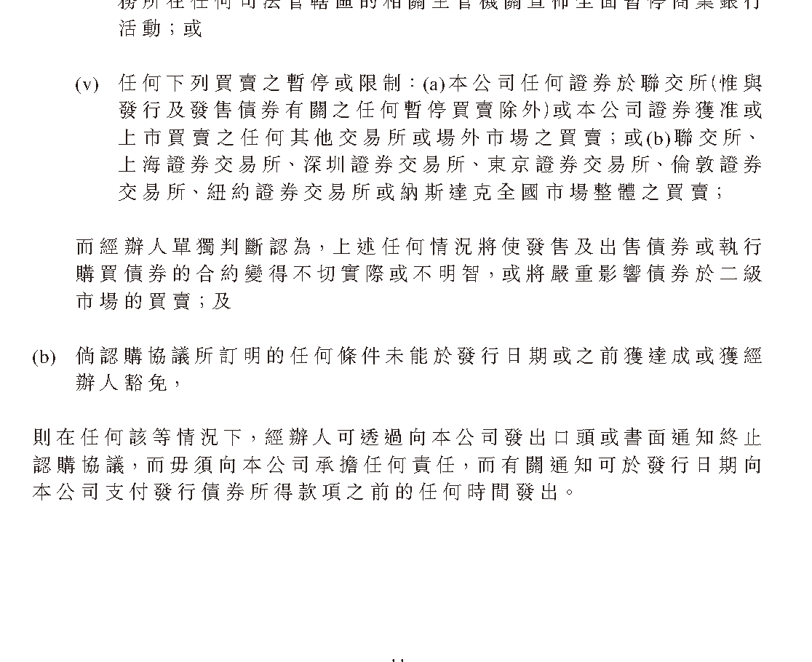

# Zhipu HKEX placing announcement: next-generation GLM with a fully self-trained (recursive self-improvement) system

> Zhipu AI (智谱) · 2026-09-13 · report · **人在环上** · [论文](https://ea-cdn.eurolandir.com/press-releases-attachments/4179721/HKEX-EPS_20260913_12330384_0.PDF)
> 机制族：立场、路线图与实验室 · 来源核验 2026-09-17 · 复现状态 not-run

## Pipeline

未发表机制。所得款项用途第 (ii) 项称下一代 GLM 将在上一代 GLM 搭建的环境中训练，形成涵盖数据自产、环境自造与基础设施自我优化的递归式自我改进闭环；预计约 393 亿港元净额中约六成投向该方向与算力（第 i 项），原生多模态、更深有效计算与长程任务强化学习另列（第 iii 项）。

*图源：Page 11, use-of-proceeds item (ii)*
## 结果（作者报告，非本地复现）

无结果——这是一次融资披露。RSI 主张是有资金承诺的计划（约 393 亿港元净额中约 235 亿投向下一代 GLM 与自训练体系），款项须于 2028-06-30 前使用。唐杰曾在 8 月业绩会上预告自进化方向。

## 证据边界

招股书式的意向声明：无架构、无基准、无产物。在论文或官方技术页出现前，本条目只跟踪已披露的方向，不证明已实现的闭环；媒体转述不得作为能力证据。

## 对 nanoRSI 的输入

对 nanoRSI：无直接应用——把智谱作为首家把递归自改进闭环写进有资金用途披露的港交所发行人来跟踪，待技术论文或 GLM-6.0 落地时再核验。

## 来源

[HKEX announcement PDF (primary)](https://ea-cdn.eurolandir.com/press-releases-attachments/4179721/HKEX-EPS_20260913_12330384_0.PDF) · [Zhipu release notes](https://docs.bigmodel.cn/cn/update/new-releases)
