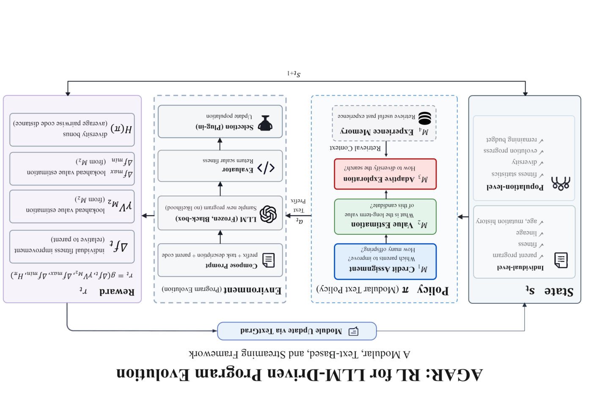

# AGAR: a reinforcement learning substrate for LLM program evolution

> University of the Chinese Academy of Sciences / Baidu / Tsinghua University / Institute of Automation, Chinese Academy of Sciences / Shanghai University · 2026-10-06 · paper · **闭环** · [论文](https://arxiv.org/abs/2610.09215)
> 机制族：程序进化与进化搜索 · 来源核验 2026-10-12 · 复现状态 not-run

## Pipeline

把 LLM 程序演化形式化为马尔可夫决策过程，其动作是模型被条件化的模块化前缀而非它输出的程序。常见循环里五个手设常量——父代选择、变异强度、多样性保持、记忆、以及不分部件归因的标量分数——分别替换为挂接到不同组件的 RL 估计器（信用分配、价值估计、自适应探索、经验记忆）。任一估计器可替换或关闭而不改动控制器，使每个迁移机制可逐一审计；后端模型不做梯度训练。

*图源：Figure 1 (framework_mdp.png, rotated upright for readability): the mixed-granularity state, the policy whose action is the modular prefix, and where RL estimators attach*
## 结果（作者报告，非本地复现）

19 个任务、两个后端（DeepSeek-V4-Flash、GLM-5.2）、三个种子、同一 harness 下，逐任务归一化的同预算最优分数：DeepSeek-V4-Flash 后端 OpenEvolve 0.855+-0.193、ShinkaEvolve 0.919+-0.138、AGAR-Base 0.949+-0.107、AGAR-Combo 0.990+-0.024；GLM-5.2 后端 OpenEvolve 0.897+-0.131、ShinkaEvolve 0.929+-0.093、AGAR-Base 0.979+-0.045、AGAR-Combo 0.972+-0.052。DeepSeek 后端下两个 AGAR 实例均高于两条基线；GLM 下 Base 领先、Combo 紧随。增益集中在竞赛编程族；五个近天花板任务压低方差。该形式化还把既有系统解读为隐式零折扣，因为适应度外在于个体。

## 证据边界

仅三个种子，作者自述只支持定性结论；两个任务（ahc015、ahc027）的 AGAR 种子不足三个；OpenEvolve 与 ShinkaEvolve 在各自 harness 下运行、任务规格由 AGAR 作者移植，harness 对齐并不严格；未找到公开代码、权重或数据，迁移消融声明无法独立复跑。

## 对 nanoRSI 的输入

对 nanoRSI 可直接移植的思路是逐机制可审计性：把演化循环的选择器、变异强度、多样性与记忆拆成可独立开关的组件，在同一 harness 下报告每个迁移估计器逐一关闭的消融，而不是整体移植框架。适应度零折扣的解读也是研究设计里值得写明的廉价检查。

## 来源

[arXiv abstract](https://arxiv.org/abs/2610.09215) · [arXiv HTML v1](https://arxiv.org/html/2610.09215v1)
