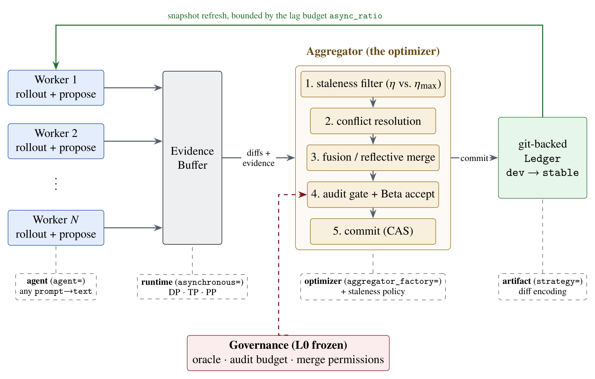

# AgentDescent: Gradient descent, but the parameters are agents

> AgentDescent project (independent, Danyang Chen) · 2026-07-26 · release · **支撑·无闭环** · [论文](https://github.com/Birfy/agentdescent) · [仓库](https://github.com/Birfy/agentdescent)
> 机制族：Harness 搜索与进化 · 来源核验 2026-09-20 · 复现状态 not-run

## Pipeline

多 worker 的自进化算法引擎：worker 并行提出对共享工件的 diff，聚合器把被接受提案合并进 git 版本化账本。策略的键空间决定并发提案能否融合——反思式合并在语义上融合，键控并集永远做不到。内置约二十个已发表自进化算法的忠实移植（GEPA、ACE、ADAS、DGM 等），分歧有文档记录且类似物明确不可作基准引用。

*图源：docs/assets/architecture.png in the repository*
## 结果（作者报告，非本地复现）

在 BBH dyck_languages（GLM-5.2，N=4，四种子）上：反思式合并融合 48 次合并机会中的 42 次，键控并集为 0/48。固定滚动预算下：模型调用少 40%（95% CI 27–54%，每个种子方向一致）；对忠实串行对照的 wall-clock 中位加速 6.8×（三种子，3.1–9.5×）；单调用路径保留集精确匹配 0.167→0.583（40 题 HotpotQA，保留 12 题）。

## 证据边界

自跑基准报告于 README/文档并给区间，未经同行评审；规模小（N=4 滚动、几十题）；引擎本身是基础设施——改进主张属于其复现的被移植算法。

## 对 nanoRSI 的输入

可移植的是合并策略教训：并行候选编辑同一共享工件时，键控/位置并工会静默丢弃重叠工作——候选合并需要语义（反思式）融合，融合结果应像其他被接受候选一样落入版本化账本。

## 来源

[GitHub repository](https://github.com/Birfy/agentdescent) · [README (results and license)](https://raw.githubusercontent.com/Birfy/agentdescent/main/README.md) · [PyPI release history](https://pypi.org/pypi/agentdescent/json)
