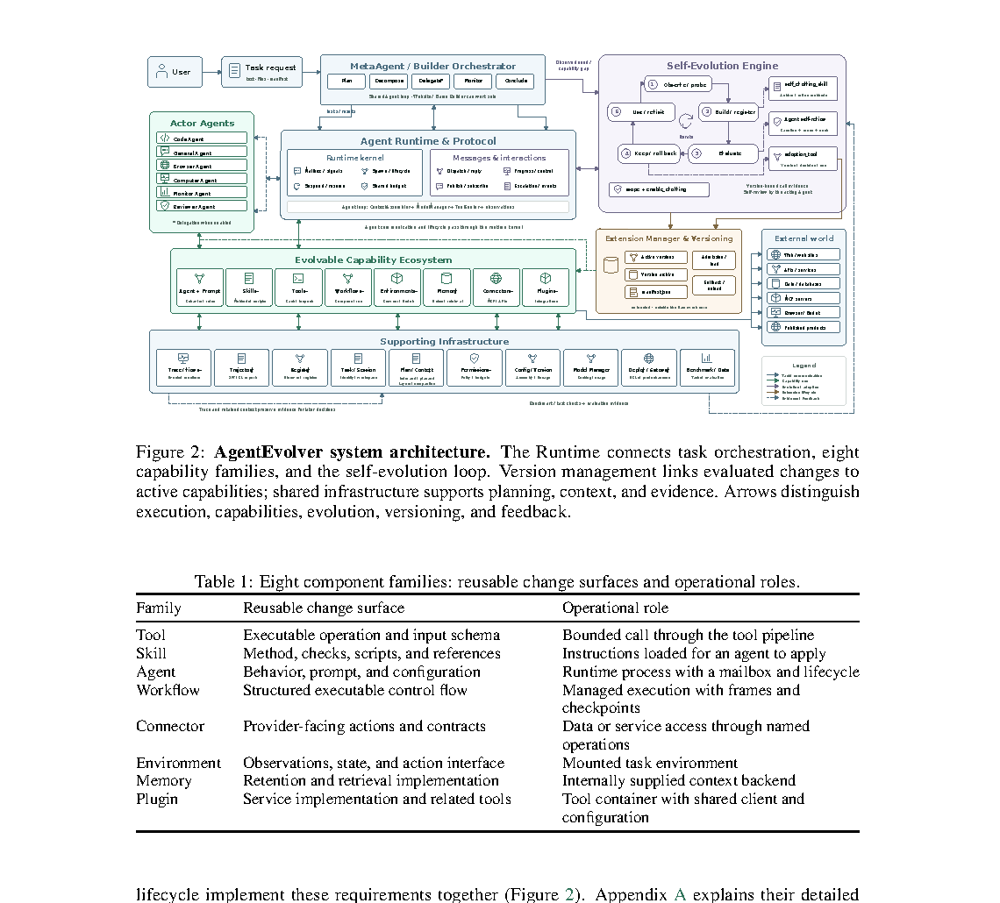

# AgentEvolver: System-Wide Self-Evolution Through Task Execution

> Nanyang Technological University / Singapore Management University · 2026-10-08 · paper · **闭环** · [论文](https://arxiv.org/abs/2610.11613) · [仓库](https://github.com/DVampire/AgentEvolver)
> 机制族：自改写元智能体与谱系 · 来源核验 2026-10-13 · 复现状态 not-run

## Pipeline

在任务执行过程中、基础模型不变的前提下构建能力：八个实体族（操作、方法、agent、控制流、接口与支撑状态等）把各自组件交给统一的带版本生命周期——结构准入、功能评估、随后激活。共享 Runtime 协调任务编排、持久规划与可恢复上下文，版本管理把每次评估过的变更链接到它所进入的生效能力集。

*图源：Figure 2, page 5 of the PDF (rendered at 150 dpi and cropped): the Runtime connecting task orchestration, the eight capability families and the self-evolution loop*
## 结果（作者报告，非本地复现）

在 SWE-bench Pro Public 上，系统报告开启演化后解决率 82.08%，高于其自身未演化基线（作者对照；论文强调区分组件改进与最终任务成功）。六个应用案例显示能力迁移到网站、游戏与研究任务，同时如实记录了未完成目标与一次失败策略；独立任务迁移与总开发成本列为开放问题。

## 证据边界

头条数字是与系统自身未演化配置比较，而非外部 SOTA agent；能力迁移只在六个自选应用案例上考察；独立任务迁移与总开发成本明确留作开放问题；论文自身即区分组件改进与最终任务成功。

## 对 nanoRSI 的输入

逐实体带版本生命周期的设计是 nanoRSI 技能轨的具体模式：给每个被编辑产物（技能文件、runner、评测器配置）同一套准入->评估->激活生命周期并把版本链接写入证据账本，使能力可回溯到产生它的变更——把 nanoRSI 已对接受代数做的审计延伸到激活一步。

## 来源

[arXiv abstract](https://arxiv.org/abs/2610.11613) · [arXiv PDF v1 (no HTML rendering exists)](https://arxiv.org/pdf/2610.11613) · [GitHub repository (MIT)](https://github.com/DVampire/AgentEvolver) · [project page](https://dvampire.github.io/AgentEvolver/)
