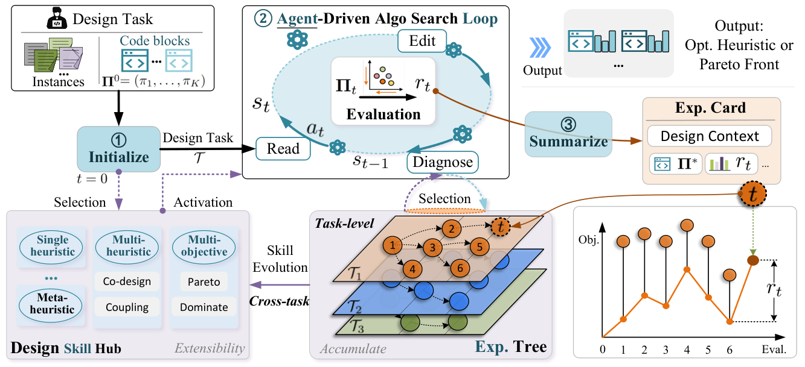

# AlgoEvo: Self-Evolving Agentic Search for Automated Algorithm Discovery

> City University of Hong Kong / Huawei Noah's Ark Lab / A*STAR · 2026-09-14 · paper · **闭环** · [论文](https://arxiv.org/abs/2609.15820)
> 机制族：程序进化与进化搜索 · 来源核验 2026-09-17 · 复现状态 not-run

## Pipeline

自治智能体依据运行时反馈检视、诊断并编辑算法代码，而非执行固定搜索管线。设计技能中心把范式专属知识外置为可插拔技能（策略角色、代码接口、修改原则、评测约定），使单一引擎覆盖单目标、多目标与多组件设计；层级经验库（经验卡、带情境 UCB 选择的任务级经验树、跨任务固化进技能）跨任务积累知识，一个模式在至少两个任务上验证后才升格为技能。

*图源：Figure 2 (S3.F2)*
## 结果（作者报告，非本地复现）

在六个任务（TSP、CVRP、Bi-TSP、Bi-FJSP、CVRP-DR、FJSP 4-Ops）上匹配或超越专用基线（EoH、ReEvo、MCTS-AHD、FunSearch、MEoH、MOTIF、E2OC 等）：TSP 最优结果仅约 39 次评估（配额 500）与 290 万 token（FunSearch 320 万）；CVRP 约 35 次评估最优（190 万 token 对 EoH/ReEvo/MCTS-AHD 约 400 万）；Bi-TSP 与 Bi-FJSP 的 HV 最优且仅 33-36 次评估；CVRP-DR 两个划分皆最优（1.392 亿 token 对 MOTIF 3.171 亿）、FJSP 4-Ops 测试最优（1.181 亿对 5.847 亿）。

## 证据边界

作者报告复杂多组件设置下 token 开销增大、对齐的问题族之外迁移效果下降；未给公开仓库地址（源码在补充材料中）。

## 对 nanoRSI 的输入

对 nanoRSI：可复用技能只有在两个及以上任务验证后才升格；经验存为卡片加带 UCB 选择的任务级树——35/500 次评估即收敛的评测预算纪律是最可迁移的部分。

## 来源

[arXiv abstract](https://arxiv.org/abs/2609.15820) · [arXiv HTML v1](https://arxiv.org/html/2609.15820v1)
