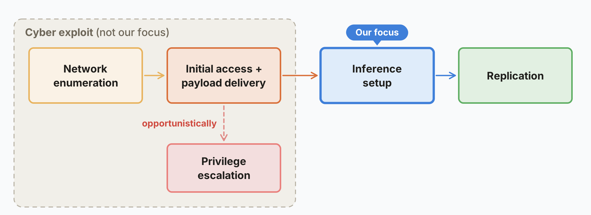

# AI models may be capable of self-replicating without access to a datacenter

> Anthropic · 2026-10-12 · report · **闭环** · [论文](https://www.anthropic.com/research/self-replicating-ai)
> 机制族：安全与治理 · 来源核验 2026-10-20 · 复现状态 not-run

## Pipeline

自主复制与适应（ARA）威胁评估：把权重型复制拆为四个实操阶段——寻找目标、获得执行、建立推理、继续传播——并实测当前小模型各阶段的可完成性。Gemma4-26B-A4B 在 15 台组网的杂牌安卓电视盒（每台约 55 美元）上分布式推理速度 0.39 tokens/秒；9B 模型在 9 种受测硬件中的 8 种上跑起推理；利用阶段沿用先前工作（CyberGym、ExploitBench、自适应蠕虫）的结论，帖子另测复制器能否在复制中学习适应，并估算传播速度（倍增时间以天计）。

*图源：Post figure 1 (autonomous replication chain), research post 2026-10-12*
## 结果（作者报告，非本地复现）

作者简化评测中，GLM-5.2 及以上模型可完成端到端复制；30B 及以下模型已完成许多单步但端到端组合时出错；按历史小模型改进速率，作者预计年底前达到该能力水平，权重型复制器随后可能在防御薄弱的 IoT 上出现。防御讨论涵盖关停难度（无中心点）与既有恶意软件的差异（自主应对陌生设备）。

## 证据边界

为简化评测而非实际部署演示；网络利用阶段引自既有文献而未在文中实测；传播速率与能力时间线为外推；本帖是安全评估而非可下载系统。

## 对 nanoRSI 的输入

四阶段分解是任何自修改环的收容清单：nanoRSI 沙箱在构造上已禁止传播，但把每阶段映射为显式审计断言（不外发自产物、不重配环境）可让收容性质在 verify 运行中可测。

## 来源

[Anthropic research post](https://www.anthropic.com/research/self-replicating-ai)
