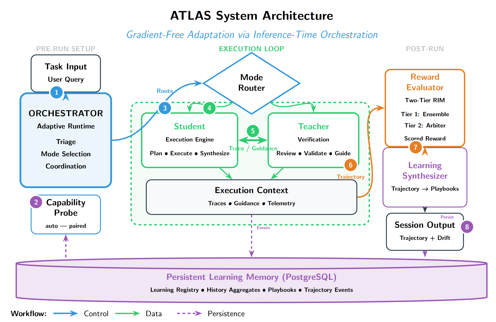

# Continual Learning, Not Training: Online Adaptation for Agents

> Arc Intelligence · 2025-11-02 · paper · **闭环** · [论文](https://arxiv.org/abs/2511.01093) · [仓库](https://github.com/Arc-Computer/atlas-sdk)
> 机制族：经验积累与回放 · 来源核验 2026-09-17 · 复现状态 not-run

## Pipeline

双智能体免梯度推理期适应：教师（GPT-5）审查学生（GPT-5-mini）的轨迹并给原则级纠正；编排器把轨迹、指引与裁判集奖励分存入持久学习记忆，蒸馏成教师手册（原则、失败模式、停止条件）与学生手册（动作模式、工具计划、防护），按任务上下文检索以调节监督力度与种子计划——全程无权重更新。

*图源：Figure 1*
## 结果（作者报告，非本地复现）

ExCyTIn-Bench 事件 #5（n=98）：ATLAS 成功率 54.1% 对 GPT-5（High）的 48.0%（+6.1），成本低约 86%（每题 0.024 对 0.174 美元），token 较学生基线降 45%；冻结手册把新事件从 28% 提到 41%（相对 +46%），非推理 token 降 52.1%。

## 证据边界

单基准评测（一个事件、n=98）；一条基线的 token 只记录了 47 次中的 42 次；泛化仅在另一个事件上测试；世界模型训练是假设未验证；作者自述静态基准不足、评测黑客风险仍在。

## 对 nanoRSI 的输入

对 nanoRSI：双层蒸馏指引（给批评者的原则层、给执行者的模式层）加监督力度调节，是单体记忆的轻量替代——且手册可干净冻结做迁移测试。

## 来源

[arXiv abstract](https://arxiv.org/abs/2511.01093) · [Paper v1 (affiliations, Figure 1, results)](https://arxiv.org/html/2511.01093v1) · [Code repository](https://github.com/Arc-Computer/atlas-sdk)
