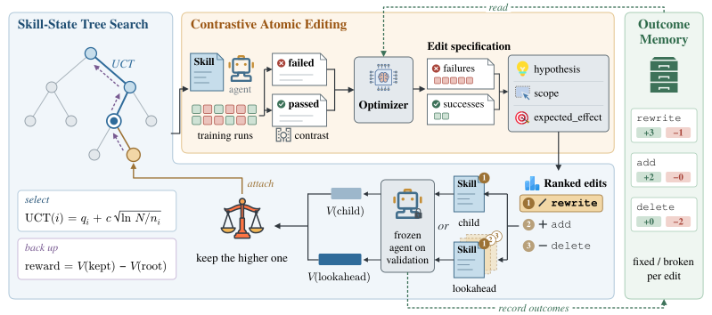

# AtomSearch: Evidence-Grounded Tree Search for Agent Skill Optimization

> 360 Security Technology Inc. · 2026-10-14 · paper · **闭环** · [论文](https://arxiv.org/abs/2610.19951)
> 机制族：技能文件优化与技能库 · 来源核验 2026-10-17 · 复现状态 not-run

## Pipeline

让技能修订动作保持局部，同时用后续技能状态引导搜索。对比原子编辑把每条最小规则编辑与失败/成功执行、一个行为假设和预期作用域绑定；技能状态树搜索评估短编辑组合并有选择地保留为可重访、可扩展的可执行状态；结果记忆向后续提案提供实测的修复与回归统计。

*图源：Figure 1 (fig_overview.svg), arXiv HTML 2610.19951v1*
## 结果（作者报告，非本地复现）

四个任务 × 五个目标模型：deepseek-v4-flash 下在 3/4 任务上超过 SkillOpt，LiveMathematicianBench 领先 9.68 个百分点，而 SkillOpt 终版技能字符数是其 2.3-19.7 倍。67% 的已完成搜索中，最优验证状态经过了在其深度上并非最高分的祖先——按即时分数贪心会丢弃通往最优的路径。

## 证据边界

未找到代码链接；对比以 SkillOpt 为主、4 任务/5 模型；修复/回归统计未由本次核验重推。

## 对 nanoRSI 的输入

“67% 经由非最高分祖先”是对纯严格闸门技能采纳（ADOPTION 53）的直接外部反证：有界技能状态树（保留但不晋升）是单编辑严格验证与多编辑提案之间缺的中间层；结果记忆（每条规则实测修复/回归）与技能轨道的证据账本字段一一对应。

## 来源

[arXiv abs 2610.19951](https://arxiv.org/abs/2610.19951) · [HTML full text v1](https://arxiv.org/html/2610.19951v1)
