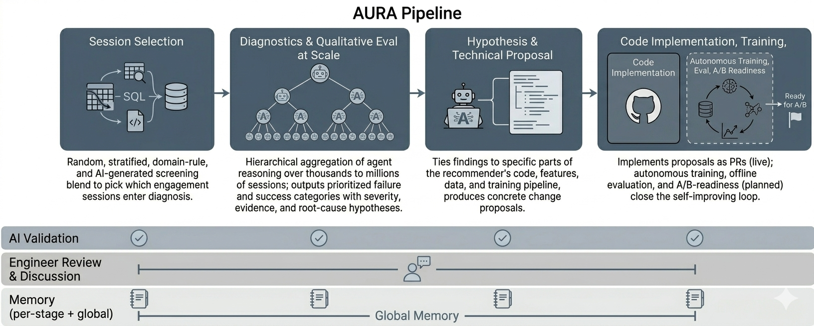

# AURA: Agentic Diagnosis and Refinement for Production Recommender Systems at Scale

> The Walt Disney Company · 2026-09-15 · paper · **闭环** · [论文](https://arxiv.org/abs/2609.16625)
> 机制族：反馈审查与编排 · 来源核验 2026-09-20 · 复现状态 not-run

## Pipeline

面向生产互动日志的端到端 agentic 管线：专职代理从真实用户会话中提炼定性失效模式（会话选择、诊断、大规模定性评估）；第二阶段将诊断与推荐系统的代码、数据和训练管线上下文结合，提出并落地代码级改进。领域细节经由配置层注入，已在两个内部平台间移植；每个 PR 由工程师审核，管线可迭代运行。

*图源：Figure 1 (aura_pipeline.png)*
## 结果（作者报告，非本地复现）

两个平台的生产诊断：评估 96,801 与 101,594 个会话，上游逐会话判 BAD 比例 19.5% 与 4.1%；多数票验证一致率 96.0%（192/200）与 87.6%（176/201）。诚实的早期阴性结果：产出的两个代码级改进未在被诊断队列（1,911 会话）上提升排序，与生产基线的差异在运行间噪声内（±0.1%）。

## 证据边界

工作坊论文，属初期测试与早期结果；除生产基线噪声外无定量对照；诚实结论是诊断质量尚未转化为排序收益；未找到代码或数据发布。

## 对 nanoRSI 的输入

可移植的是配置层解耦：把 nanoRSI 的任务域细节放进配置层，使诊断→代码改进循环可以不改循环本身而切换到新任务族；改进未超过基线噪声时如实记录零结果。

## 来源

[arXiv abstract](https://arxiv.org/abs/2609.16625) · [arXiv HTML v1](https://arxiv.org/html/2609.16625v1)
