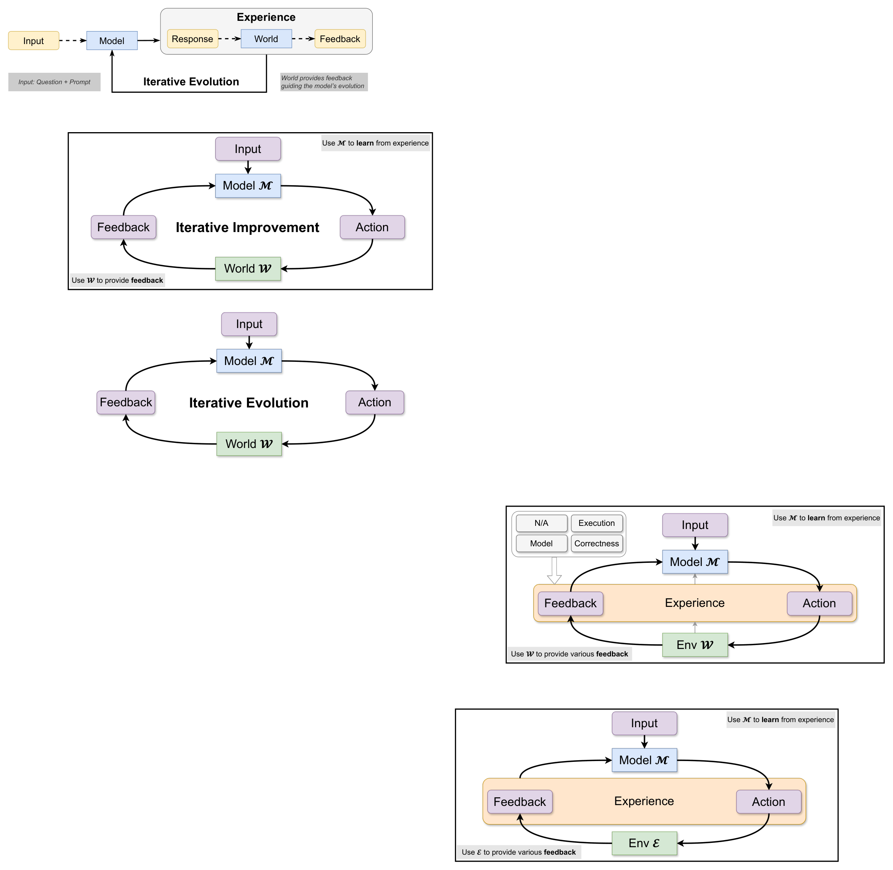

# Chain-of-Experience for Continual LLM Improvement

> ByteDance Seed / UC Santa Cruz · 2026-08-18 · paper · **闭环** · [论文](https://arxiv.org/abs/2608.18027)
> 机制族：经验积累与回放 · 来源核验 2026-09-14 · 复现状态 not-run

## Pipeline

测试时经验学习：模型不再单轮推理，而是在迭代解题中累积自身经验轨迹（提问、尝试、正确性或测试通过反馈），这些轨迹供后续尝试使用，形成经验链（CoE）。研究比较了反馈来源（自我反馈与环境反馈）、通道组合以及保留策略，包括刻意保留"混乱"的失败轨迹。

*图源：Figure 2*
## 结果（作者报告，非本地复现）

在八个 LLM（含 GPT-5、Gemini-2.5 Pro、Claude-4.5 Sonnet）的数学/代码/知识任务上，迭代经验相对无反馈基线整体提升 5.6%，同时 API 成本降低 19%；组合互补反馈通道带来额外收益，单位 token 准确率优于其他测试时方法，且对弱反馈或噪声反馈稳健。

## 证据边界

收益属于固定模型上的有界测试时适应：无权重更新，且按字节官方页的定位是"超越零样本推理的持续改进"，而非可学习更新器的跨任务迁移。百分比为作者在自选基准集上的汇总。

## 对 nanoRSI 的输入

建议：在 nanoRSI 的数字/编程任务上，在固定 token 预算下比较单通道执行反馈与自我+环境反馈组合，并检验保留失败轨迹（而非只留成功）是否改变隐藏集准确率。

## 来源

[arXiv abstract (v1 date, license)](https://arxiv.org/abs/2608.18027) · [Paper HTML (loop figures, results)](https://arxiv.org/html/2608.18027v1) · [ByteDance Seed official publications page (2026.08.18)](https://seed.bytedance.com/zh/public_papers)
