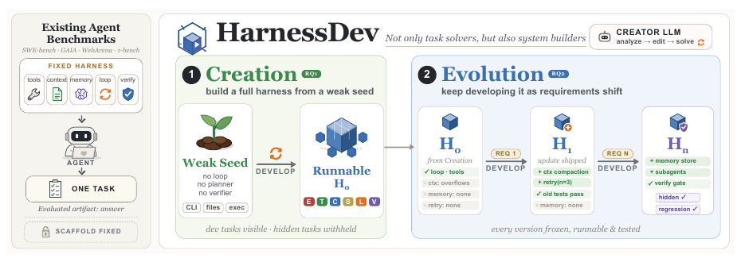

# HarnessDev: Can LLMs Create and Evolve Their Own Agent Harness?

> ByteDance Seed / Singapore University of Technology and Design / Georgia Institute of Technology / M-A-P / TokenWave.AI · 2026-09-01 · paper · **闭环** · [论文](https://arxiv.org/abs/2609.01437)
> 机制族：Harness 搜索与进化 · 来源核验 2026-09-13 · 复现状态 not-run

## Pipeline

Creation 从弱种子构建可运行框架；Evolution 根据下游执行反馈反复修改持久框架。正式版本冻结后在隐藏任务上评测，衡量跨任务复用而非单份输出修补；固定运行模型的对照评估可迁移性。

*图源：Figure 1, PDF p.2*
## 结果（作者报告，非本地复现）

九条单次进化轨迹中，可见分数与隐藏分数的变化方向仅在 34/64 次相邻版本切换中一致（53.1%）；仅 2/9 个声明最终版本在隐藏集上最优。Creation 覆盖六个创建模型、四个领域和 2,207 个下游实例。

## 证据边界

这是受限直接闭环的基准研究，不证明稳定累积改进；最终选定产物可能退化，收益依赖执行模型。

## 对 nanoRSI 的输入

拟议 nanoRSI coding 实验：冻结每个候选版本，保留完整评分轨迹，在固定执行模型下衡量开发集与隐藏集提升方向的一致性。

## 来源

[arXiv first submission](https://arxiv.org/abs/2609.01437) · [Paper v1](https://arxiv.org/html/2609.01437v1) · [Official Self-Developing Agents project](https://self-developing-agents.github.io/)
