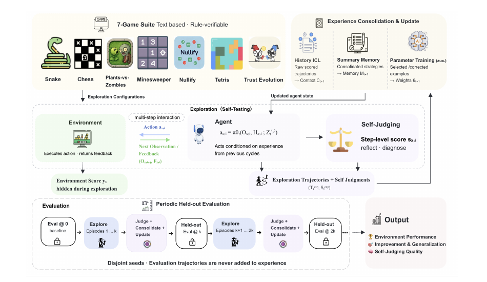

# S3Gym: Can LLMs Turn Self-Testing and Self-Judging into Self-Improvement?

> ByteDance Seed / M-A-P / TokenWave.AI · 2026-08-31 · paper · **闭环** · [论文](https://arxiv.org/abs/2608.31100)
> 机制族：记忆进化评测研究 · 来源核验 2026-09-13 · 复现状态 not-run

## Pipeline

智能体探索游戏并自评决策，在后续回合复用原始历史、按分数整理的记忆摘要或经验训练后的参数。主要探索阶段的可执行验证器奖励留在基准侧，通过更严格且隔离的评测检查继承状态是否改善行为；没有通用的收益准入门。

*图源：Figure 2, PDF p.7*
## 结果（作者报告，非本地复现）

七个游戏中，自评质量与下一次严格评测提升的分块相关系数接近零：事件一致性为 −0.010，负校准误差为 −0.018。这些是相关系数而非提升百分比。不同任务适合不同上下文路径，参数训练可能产生负迁移。

## 证据边界

证据限于特定游戏；识别成功不保证形成有效记忆或可迁移策略。

## 对 nanoRSI 的输入

拟议 nanoRSI skills 消融：比较原始历史、摘要记忆与冻结状态，构建记忆时隐藏验证器分数。

## 来源

[arXiv first submission](https://arxiv.org/abs/2608.31100) · [Paper v1 methods and Table 6](https://arxiv.org/html/2608.31100v1) · [Official Self-Developing Agents project](https://self-developing-agents.github.io/)
