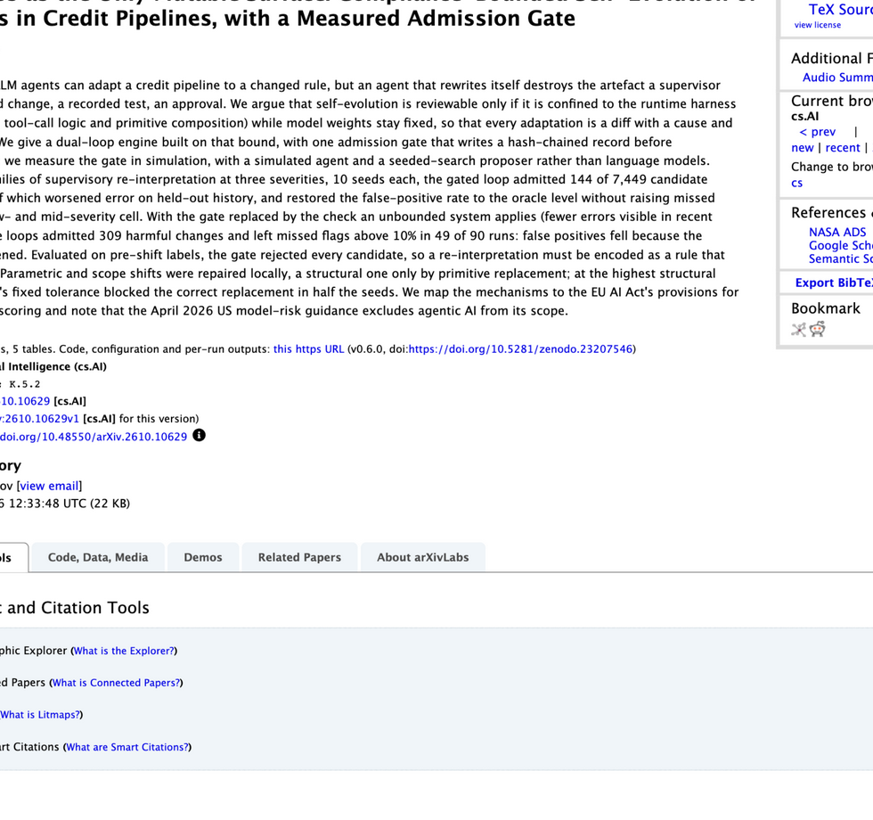

# The Harness as the Only Mutable Surface: Compliance-Bounded Self-Evolution of LLM Agents in Credit Pipelines, with a Measured Admission Gate

> Digital Economy Lab · 2026-10-07 · paper · **闭环** · [论文](https://arxiv.org/abs/2610.10629) · [仓库](https://github.com/rav11l/cace-bench)
> 机制族：安全与治理 · 来源核验 2026-10-11 · 复现状态 not-run

## Pipeline

只有 LLM 信贷流水线智能体的运行时 harness 可变——指令文本、工具调用逻辑与原语组合——模型权重保持冻结，因此每次适配都是可评审的 diff 并附带原因与测试。双环引擎控制部署：准入闸门在变更获准前记录哈希链式证据（注册的选择、运行义务、声明范围），且闸门自身的准入/拒绝统计作为量测控制与无界筛选基线对照报告。

*图源：arXiv abstract page, title/authors/submission-date/abstract crop (2026-10-11)*
## 结果（作者报告，非本地复现）

作者报告的仿真结果（三类漂移 × 三档严重度 × 各 10 个种子）：带闸门循环准入 7,449 个候选变更中的 144 个，无一恶化留出误差，在全部低/中严重度单元把误报率恢复到 oracle 水平且未增加漏检；把闸门换成无界的近期轨迹筛选则准入 309 个有害变更，90 次运行中 49 次漏检超过 10%；对漂移前标签闸门拒绝一切。结构性漂移需要原语替换，固定容差在最高严重度种子的一半中被卡住。所有数字来自模拟智能体加种子化搜索提案器，不是真实语言模型调用。

## 证据边界

评测是基于种子化搜索提案器与模拟智能体的仿真，不是真实 LLM 循环；领域是对映到欧盟 AI Act 高风险信贷条款的合规场景；实验室为单作者，除其自有材料外无法进一步核实。有害准入计数依赖作者选择的合成漂移族与严重度设置。

## 对 nanoRSI 的输入

可移植思路是'量测闸门'报告：把准入/拒绝计数、有害准入反事实与部署前拒绝行为作为 nanoRSI 自身闸门证据账本的一等字段，与既有反事实挑战者研究互相印证。冻结契约下的 harness-only 变更与逐变更记录原因/测试已接近 nanoRSI 现有设计；把这视为对报告形态的印证，而不是代码依赖。

## 来源

[arXiv abstract](https://arxiv.org/abs/2610.10629) · [arXiv HTML v1](https://arxiv.org/html/2610.10629v1) · [MIT benchmark and reference implementation](https://github.com/rav11l/cace-bench) · [MIT license and NOTICE](https://github.com/rav11l/cace-bench/blob/main/LICENSE) · [Synthetic dataset on Hugging Face](https://huggingface.co/datasets/rav11l/cace-bench)
