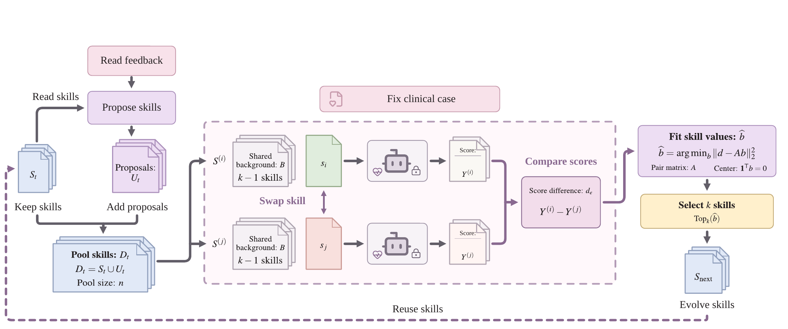

# CausalEvo: Causal Skill Self-Evolution for Health LLM Agents

> University of Texas Health Science Center at Houston · 2026-10-14 · paper · **闭环** · [论文](https://arxiv.org/abs/2610.21016) · [仓库](https://github.com/txbrook/CausalEvo)
> 机制族：技能文件优化与技能库 · 来源核验 2026-10-18 · 复现状态 not-run

## Pipeline

冻结 LLM 每步提出两条新技能规则，与四条在位规则合并为候选集（在位者永远可选）。技能价值用因果方式估计而非裸面板分数：在候选集的随机重标环上，对每条有向边用相同反馈案例跑两次——共享 k-1 条背景规则、只交换被换的那条（等规则数把内容效应与规模效应分开）；零和约束的最小二乘把成对分数差解为相对技能价值，选择按字典序——先总和最高、平局偏向在位集合。决策损失界把误差分解为候选支撑、逼近（超出线性投影的规则交互）与估计三部分，并给出精确系数仍会因互补性选错的显式反例。

*图源：Figure 1 (figures/causalevo_overview.png), arXiv HTML 2610.21016v1*
## 结果（作者报告，非本地复现）

在六个 MedCalc-Bench-Verified 任务上（120 留出例、每任务 20、DeepSeek V4 Flash 0731 关思考）：CausalEvo 60.00% 对 SkillOpt 55.83% 对无技能 51.67%，训练 token 少 55.6%（2.203M 对 4.961M；336 对 839 次请求），终版技能 180 词对 999 词。信用分配消融（独立 24 例集）：70.83% 对打乱信用 62.50%（+8.33pp，区间含零）。

## 证据边界

增益几乎全部集中在 Cockcroft-Gault（+9 例），其余五任务合计 -4；Child-Pugh 从 50% 回退到 30%，且该任务无技能基线胜过两个方法；Holm 校正后不显著（配对区间含零，对 SkillOpt [-5.00, 13.33])；即时学习获取为负（-3.33pp）；每方法单条训练轨迹且预算/后端/技能长度不一；可能过拟合 3 例反馈面板；参考标签存在争议；无临床验证。

## 对 nanoRSI 的输入

共享背景下的成对交换是技能闸门上廉价的归因层：让候选编辑按配对方式计分而非信任裸面板差值，使技能因边际贡献而非面板噪声晋升；论文的报告范式（点名增益集中任务、做 Holm 校正、声明单轨迹局限）正是选择器研究应对齐的诚实标准。

## 来源

[arXiv abs 2610.21016](https://arxiv.org/abs/2610.21016) · [arXiv HTML v1](https://arxiv.org/html/2610.21016v1) · [CausalEvo code](https://github.com/txbrook/CausalEvo)
