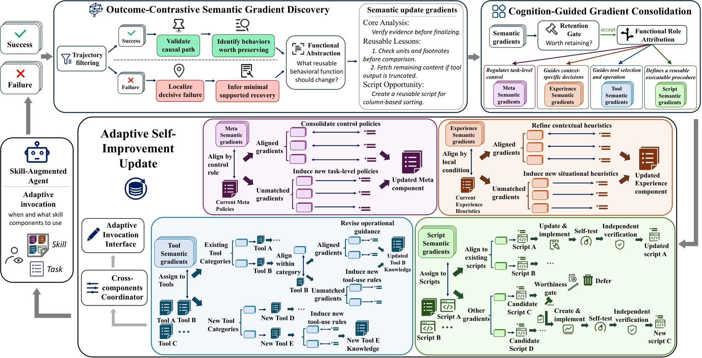

# From Trajectories to Differentiated Skills: Cognitive Differentiation for Self-Improving Agents

> University of Science and Technology of China / Meituan / City University of Hong Kong · 2026-10-19 · paper · **闭环** · [论文](https://arxiv.org/abs/2610.23599)
> 机制族：技能文件优化与技能库 · 来源核验 2026-10-20 · 复现状态 not-run

## Pipeline

技能演化中的认知分化（CDSE）：统一技能通过四个功能不同而协同的组件——Meta、Experience、Tool、Script——演化。从成功与失败轨迹提取有据可依的语义梯度，经保留闸门按功能角色巩固，再以组件特定更新与验证、跨组件协调及自适应调用（决定哪些组件进入当前任务上下文）落地。

*图源：Figure 3 (method-shao.png), arXiv HTML 2610.23599v1*
## 结果（作者报告，非本地复现）

对 500 个广泛使用技能包的分析发现 96.8% 至少跨两个功能角色。在六个基准（OfficeQA、SpreadsheetBench2、SealQA、LiveMathBench、SWE-Pro、AutomationBench）、三个模型（GLM-5.2、DeepSeek-V4-Flash、MiniMax-M3）与两个执行 harness（Claude Code、Codex）下（2:7 训练/测试切分），CDSE 在全部 36 个设定中得分最高：平均比 Base 智能体 +7.6 个点，比每个设定中最强的竞争技能演化方法（Trace2Skill、SkillOpt-lite、EvoSkill）+2.6 个点；单轮 token 开销各方法相当。

## 证据边界

四组件分类学是认知科学启发的设计承诺而非推导出的必然；相对强未分化基线的优势为中等（+2.6）；评测用闭源 harness 与固定模型，技能演化在各基准 2/9 训练切分上训练。

## 对 nanoRSI 的输入

把 nanoRSI 技能文件按 CDSE 四角色拆分并配组件级编辑预算（延伸 ADOPTION #53 文本学习率）与组件级接受检查；自适应调用对应按需加载组件，可在 skills 模板最小任务上直接检验。

## 来源

[arXiv abs 2610.23599](https://arxiv.org/abs/2610.23599) · [arXiv HTML v1](https://arxiv.org/html/2610.23599v1)
