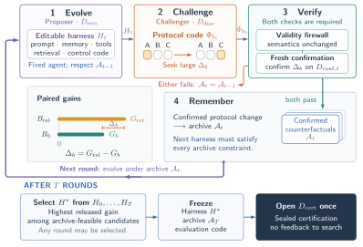

# Bad Genius: Counterfactual-Guided Harness Evolution Beyond Task-Specific Shortcuts

> University of Chinese Academy of Sciences / National University of Singapore / Institute of Automation, CAS · 2026-09-16 · paper · **闭环** · [论文](https://arxiv.org/abs/2609.18366)
> 机制族：Harness 搜索与进化 · 来源核验 2026-09-18 · 复现状态 not-run

## Pipeline

提案者进化目标智能体的 harness（提示、记忆、检索、工具、控制代码）；挑战者搜索保持任务有效性的基准反事实变体，确认档案会把在反事实下不再成立的增益降级，针对逐任务留集漏掉的基准级捷径。

*图源：Figure 2 (figure2_CHASE_pipeline.svg)*
## 结果（作者报告，非本地复现）

OfficeQA（每题 3 次滚动）上进化后 harness 的 R̂avg,A3 达 68.42%，对照原始 harness 66.23%（+2.19）；ProV2 切片 30.37% 对 27.04%（+3.33）；合成基准 Syn-Ledger 用于分离捷径行为；去掉挑战者的 HarnessCompass 变体得分低于原始 harness。

## 证据边界

绝对增益温和；评测仅 OfficeQA 加合成基准；作者自报。

## 对 nanoRSI 的输入

把挑战者移植进 nanoRSI 闸门：在最小任务集自动生成的保有效性反事实上重测被接受候选；在那里消失的增益标记为捷径而非技能。

## 来源

[arXiv abstract](https://arxiv.org/abs/2609.18366) · [Paper HTML (affiliations, Figure 2, OfficeQA table)](https://arxiv.org/html/2609.18366v1)
