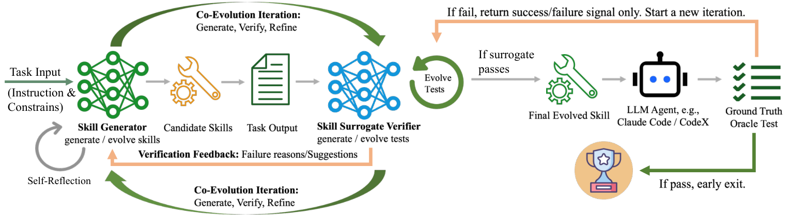

# CoEvoSkills: Self-Evolving Agent Skills via Co-Evolutionary Verification

> University of Illinois Chicago / MBZUAI / McGill University / Columbia University / Zhejiang University 等 · 2026-04-02 · paper · **闭环** · [论文](https://arxiv.org/abs/2604.01687) · [仓库](https://github.com/Zhang-Henry/CoEvoSkills)
> 机制族：技能文件优化与技能库 · 来源核验 2026-09-19 · 复现状态 not-run

## Pipeline

技能生成器产出多文件技能包，共同进化的代理验证器仅凭结构化失败反馈把关；ground-truth oracle 保持信息隔离（只给不透明 pass/fail）并触发测试升级，技能与验证器在无标注下互相自举。

*图源：Figure 3 (process.png)*
## 结果（作者报告，非本地复现）

SkillsBench（Claude Opus 4.6 + Claude Code）：通过率 71.1%，对照无技能 30.6%（+40.5pp）、人工技能 53.5%（+17.6pp）、Anthropic Skill-Creator 34.1%；GPT-5.2 自进化 69.8% vs 29.6%；Opus 进化出的技能迁移到另外六个模型增益 +35~+44pp（如 Haiku 4.5：54.5% vs 10.4%）。

## 证据边界

作者自报且集中于单一基准族；验证器在其反馈预算内仍可能被欺骗，论文度量技能通过率而非下游递归复利。

## 对 nanoRSI 的输入

nanoRSI skills starter 可借鉴信息隔离验证器模式：严格闸门只看结构化失败反馈，oracle 只发不透明 pass/fail，oracle 调用触发验证器测试升级。

## 来源

[arXiv abstract](https://arxiv.org/abs/2604.01687) · [Paper HTML (affiliations, Table 3, Figure 3)](https://arxiv.org/html/2604.01687v3) · [Code repository](https://github.com/Zhang-Henry/CoEvoSkills)
