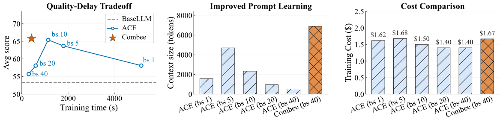

# Combee: Scaling Prompt Learning for Self-Improving Language Model Agents

> Stanford University / UC Berkeley / Tensormesh / Gradient Network · 2026-04-05 · paper · **支撑·无闭环** · [论文](https://arxiv.org/abs/2604.04247)
> 机制族：Harness 搜索与进化 · 来源核验 2026-09-18 · 复现状态 not-run

## Pipeline

并行扫描、增强洗牌机制与动态批大小控制器让多个智能体并行做提示学习并从合并轨迹中学习而不损质量——把自改进循环横向而非串行扩展。

*图源：Figure 1 (intro_fig.svg)*
## 结果（作者报告，非本地复现）

在 AppWorld、Terminal-Bench、Formula、FiNER 上（头条快照为 DeepSeek-V3.1 底座），相对既有提示学习方法最高 17× 加速，精度持平或更优、成本相当。

## 证据边界

作者自报；加速相对既有提示学习流水线而非单次运行质量上限；仅覆盖智能体任务。

## 对 nanoRSI 的输入

nanoRSI 种群运行已并行评测；Combee 可借鉴的是运行中洗牌——候选在代际边界之前就周期性交换已学提示内容。

## 来源

[arXiv abstract](https://arxiv.org/abs/2604.04247) · [Paper HTML (affiliations, Figure 1)](https://arxiv.org/html/2604.04247v1)
