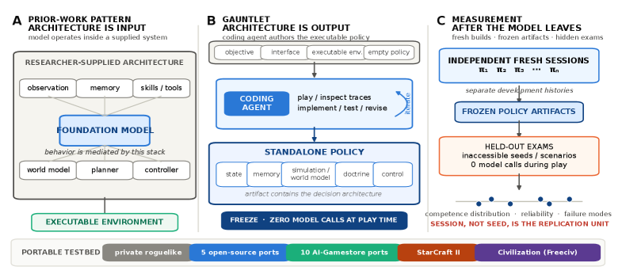

# Compiled Agency: Frontier General-Purpose Coding Agents Build Winning Game Players from Bare Interaction - from Flappy Bird to StarCraft II and Civilization

> New York University / Princeton University · 2026-09-17 · paper · **支撑·无闭环** · [论文](https://arxiv.org/abs/2609.18996)
> 机制族：程序进化与进化搜索 · 来源核验 2026-09-20 · 复现状态 not-run

## Pipeline

Gauntlet 是开发-冻结-评测框架：通用编码代理只拿到游戏描述、原始观测/动作接口和一份空策略文件——不给策略、算法或架构。在单次自主会话中与真实游戏交互试错并写出独立控制器，随后冻结并在保留实例上评测，游玩期间零模型调用。冻结产物可检查。

*图源：Figure 1 (x1.png)*
## 结果（作者报告，非本地复现）

在一个未公开的程序化 roguelike 上，保留集成功率跨度 0–86%，并呈现清晰的代际门槛：最新一代系统的每个观测会话都胜过上一代的最佳会话。编译出的原始 API 星际争霸 II 控制器击败全部公平内置 AI 与两个作弊变体；单会话程序在保留种子上以完全征服赢得整局文明（Freeciv）——对新手 AI 胜率不高，但号称是无逐回合模型调用、无手工战术层的独立语言代理系统首例。

## 证据边界

Freeciv 胜率仅对新手 AI 且不高；roguelike 结果依赖未公开私设游戏；未找到代码或 harness 发布；核验时仅一版。

## 对 nanoRSI 的输入

冻结后评测的契约可直接映射到 nanoRSI 终测：候选冻结后，评测必须在保留种子上零额外模型调用运行，任何运行时自改都会作为契约违例显形。

## 来源

[arXiv abstract](https://arxiv.org/abs/2609.18996) · [arXiv HTML v1](https://arxiv.org/html/2609.18996v1)
