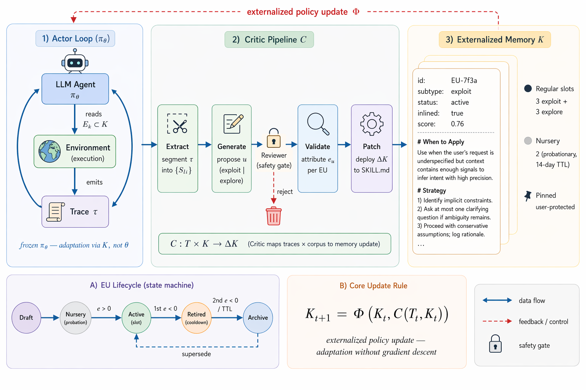

# Darwin-Claw: Environment-Adaptive Experience Consolidation for Recursively Self-Evolving Agents

> Zhejiang University / Tencent / Zhongguancun Academy · 2026-10-19 · paper · **闭环** · [论文](https://arxiv.org/abs/2610.23574)
> 机制族：经验积累与回放 · 来源核验 2026-10-20 · 复现状态 not-run

## Pipeline

层次化经验巩固系统从用户交互轨迹提取细粒度错误归因，泛化为动态更新的环境原型向量；巩固后的情境经验被两用——作为交互补丁注入以增强上下文感知，并作为显式优化信号在 Externalized 演化生命周期（因果验证与多维评分闸门）下精炼操作技能与持久记忆。理论上表述为冻结基座上的智能体执行者/演化批评者迭代协同适应。

*图源：Figure 1 (figures/framework.png), arXiv HTML 2610.23574v1*
## 结果（作者报告，非本地复现）

WildClawBench（60 条人写的长程多模态任务、六类）：较无演化基线平均 +24.1 个百分点，网页 +27.3、工具 +31.6、推理密集 +22.7、长程 +23.8；按难度从简单 +18.5 到极端 +33.2。在 RSIBench-Data 自动研究任务上（Claude Code 与 Codex 双 harness、四个 LLM），24 项中 19 项优于基座（绝对 +32.00 SWE-V、+15.28 AIME、+15.08 Terminal-Bench 2.0），且在全部六个基准上超过上下文直传式演化基线。

## 证据边界

改进是相对作者所选基线在其基准套件上的结果；原型向量与经验池需要本地存储基础设施；核验时未放出代码，巩固管线无法独立复核。

## 对 nanoRSI 的输入

先聚类错误归因再落盘：nanoRSI 可对每次失败尝试的归因向量分类，路由到技能文件编辑、记忆追加或丢弃——这是对“逢败必改技能”的结构化替代，可在 counterfactual 面板上检验。

## 来源

[arXiv abs 2610.23574](https://arxiv.org/abs/2610.23574) · [arXiv HTML v1](https://arxiv.org/html/2610.23574v1)
