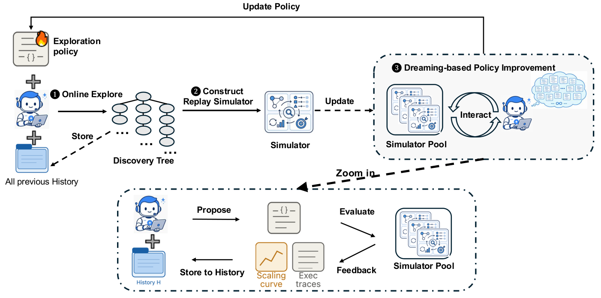

# Dream-RSI: Recursive Self-Improvement through Evolving Worlds

> University of Maryland, College Park / Google DeepMind / University of Virginia · 2026-09-14 · paper · **闭环** · [论文](https://arxiv.org/abs/2609.14858) · [仓库](https://github.com/zhengkid/Dream-RSI)
> 机制族：程序进化与进化搜索 · 来源核验 2026-09-21 · 复现状态 not-run

## Pipeline

发现历史被组织成树，节点存每次尝试的工作区、工件、诊断与得分；这棵树成为回放模拟器——备选探索策略以不同顺序、并行分组与停止点'导航'已记录分支，无需重跑底层智能体。策略开发 LLM 迭代改写探索策略代码，每个版本按平衡最优得分、执行成本与并行度的回放目标打分；最优策略重新上线，新历史又扩充模拟器池。

*图源：Figure 1*
## 结果（作者报告，非本地复现）

算法工程（Lasso、6 个留出数据集）：Gemini-3.1-Pro 下 Dream-RSI 以 317 次调用达均值 2,931ms，对固定探索 550 次的 3,587ms；Gemini-3.7-Flash 下 1,879 次调用 2,350.6ms 对 3,200 次的 2,516.7ms（SimpleTES 需 51,200 次）。内核工程：VGG16/LayerNorm 以少 2.43/1.79 倍生成数持平；ConvDiv 同预算下 +2.09 倍得分。

## 证据边界

回放只对已记录分支确定性有效——无法评估真正新颖的方向；增益仅见于 3 域 8 任务；需要结构化发现树；离线策略迭代仍耗 LLM 调用。

## 对 nanoRSI 的输入

对 nanoRSI：把运行档案复用为免费模拟器——在花费任何新评估之前，让备选提案/调度策略在已记录的候选树上回放打分；这是有界环可用的最廉价策略改进形式。

## 来源

[arXiv abstract](https://arxiv.org/abs/2609.14858) · [Paper v1 (affiliations, Figure 1, tables)](https://arxiv.org/html/2609.14858v1) · [Code repository](https://github.com/zhengkid/Dream-RSI)
