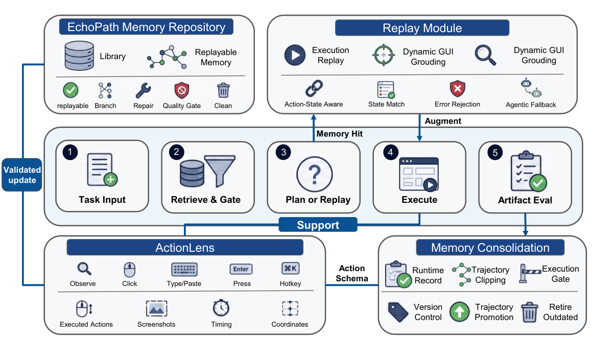

# EchoPath: Execution-Level Replayable Memory for GUI Agents

> Johns Hopkins University / Amazon AGI · 2026-09-15 · paper · **闭环** · [论文](https://arxiv.org/abs/2609.16635)
> 机制族：经验积累与回放 · 来源核验 2026-09-19 · 复现状态 not-run

## Pipeline

经验证的 GUI 轨迹被编译为标准化、参数可控的可调用记忆（任务意图键、前置条件、参数、GUI 证据、验证出处、生命周期状态）。基于图像的目标重瞄算法在回放前把存储的 GUI 目标与当前屏幕重新匹配并校正坐标，只重绑定声明的可变输入。生命周期状态（候选、活跃、隔离、修复分支、合并、弃用）约束检索可见范围。

*图源：Figure 1 (S2.F1)*
## 结果（作者报告，非本地复现）

OSWorld-Verified 配对两遍设计（第二遍在改变分辨率后回放）：回放保持成功率——Codex 145/159（91.2%）、Claude 92.8%、Kimi 87.3%，与 Synapse 规划增强基线（91.8%）相当。第二遍中位成本：20,370 token 与 127.5 秒，对比 Synapse 586,386 token 与 315.7 秒（中位 token 成本降逾 90%、执行时间降约 60%）；首遍构建约耗 57.2 万 token、4.5 分钟。

## 证据边界

最适合稳定环境：视觉重瞄对工具栏重排、本地化、响应式布局、显示缩放与近重复 UI 元素仍然脆弱；界面漂移下的在线稳健性未验证；记忆获取需完整自治首遍而非用户演示。

## 对 nanoRSI 的输入

对 nanoRSI：把执行级技能存为自带验证出处与生命周期状态的可调用记忆，检索只暴露活跃项——回放即可用十分之一 token 换取大部分收益。

## 来源

[arXiv abstract](https://arxiv.org/abs/2609.16635) · [arXiv HTML v1](https://arxiv.org/html/2609.16635v1)
