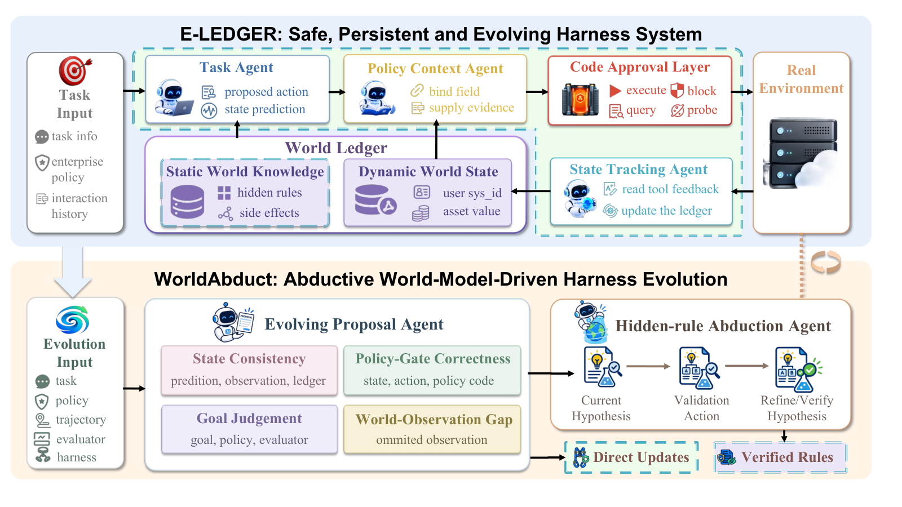

# Safe, Persistent, and Evolving Agent Harness for Understanding Partially Observable Worlds

> Hong Kong University of Science and Technology / Lightspeed / Independent · 2026-10-08 · paper · **闭环** · [论文](https://arxiv.org/abs/2610.11552) · [仓库](https://github.com/HKUST-KnowComp/E-LEDGER-WorldAbduct)
> 机制族：Harness 搜索与进化 · 来源核验 2026-10-13 · 复现状态 not-run

## Pipeline

E-Ledger 是带代码审批层的多 agent harness：每个动作先过策略检查再执行，并维护已验证隐藏规则加证据支撑动态状态的账本。WorldAbduct 用溯因演化该 harness：跨四个视图（状态一致性、世界-观测差、策略闸正确性、目标判断）诊断执行轨迹以假设潜规则，经定向溯因交互验证后才写入账本。

*图源：Figure 2 (frame.png): E-Ledger multi-agent runtime with the code approval layer and world ledger (top) and the WorldAbduct four-view abductive evolution pipeline (bottom)*
## 结果（作者报告，非本地复现）

在企业 World of Workflows 基准上，WorldAbduct 在四个后端上均取得最高安全任务完成率（DeepSeek-V4-Pro 80 STCR / 85 TCR / 95 PSR；GLM-5.3-Flash 75/80/95；Kimi-K3 70/75/95；GPT-5.6-Terra 65/65/100），比最强演化基线 MemoHarness 高 5-15 个百分点（GLM：75 对 65 STCR；DeepSeek：80 对 75；GPT-5.6：65 对 50）。消融：去掉静态世界层 GLM STCR 从 75.0 跌到 40.0；去掉溯因 PSR 从 95 降到 85。账本冻结的 54 条事实中 49 条全对、5 条部分正确、0 条错误。溯因演化迁移到 ScienceWorld（71.7 成功率）与 DiscoveryWorld（93.8 成功率，约 ReAct 三分之一步数）。

## 证据边界

WorldAbduct 比轻量基线用更多交互步数与成本（GPT-5.6：22.4 步 / 3.75 美元，对 WorldEvolver 13.4 步 / 1.72 美元）；GPT-5.6-Terra 保守性限制了任务完成率增益；64 次溯因检查中 6 次未解决；企业基准为自建。

## 对 nanoRSI 的输入

账本纪律是可移植模式：假设规则只有经定向验证交互后才进入持久状态，harness 修订由四视图失败诊断驱动——是 nanoRSI「失败后蒸馏」技能循环带逐规则显式准入检查的结构化版本。

## 来源

[arXiv abstract](https://arxiv.org/abs/2610.11552) · [arXiv HTML v1](https://arxiv.org/html/2610.11552v1) · [GitHub repository (no license file)](https://github.com/HKUST-KnowComp/E-LEDGER-WorldAbduct)
