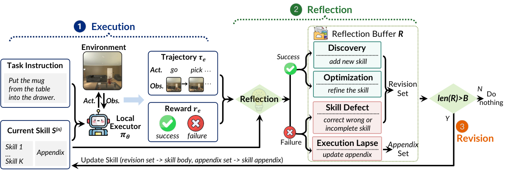

# EmbodiSkill: Skill-Aware Reflection for Self-Evolving Embodied Agents

> Huazhong University of Science and Technology / University of Science and Technology of China / Microsoft Research / Institute for AI Industry Research (AIR), Tsinghua University / Nanjing University · 2026-05-11 · paper · **闭环** · [论文](https://arxiv.org/abs/2605.10332) · [仓库](https://github.com/air-embodied-brain/EmbodiSkill)
> 机制族：技能文件优化与技能库 · 来源核验 2026-09-16 · 复现状态 not-run

## Pipeline

免训练闭环，为冻结执行器进化二段式程序技能 S = (S_body, S_app)。每条轨迹相对当前技能解读并按证据类型拆分：技能变更类证据（Discovery、Optimization、SkillDefect 反思）整合后对技能主体做定向编辑，模型扮演受限编辑者而非自由重写者；执行失察类证据（智能体没有遵循有效指引）只更新附录，重新强调既有有效内容而非改写。修订集超过预算则本轮空转。

*图源：Figure 2*
## 结果（作者报告，非本地复现）

ALFWorld（3,553 训练 / 134 测试任务，K=1，10 个修订阶段）上，冻结的 Qwen3.5-27B 执行器达 93.28% 成功率，比无技能直用 GPT-5.2 高 31.58 分；Puttwo 子任务 100.00% 对 G-Memory 的 52.94%。消融：无技能 61.19 -> 静态技能 73.13 -> 无技能感知反思 78.36 -> EmbodiSkill 93.28（感知增量 +14.92）。EmbodiedBench：EB-Habitat 最高均值 52.33%（比最强记忆基线 +16.29），EB-Navigation 61.33%（+17.94）。收益随骨干组合变化：配 Gemini 时 Qwen3.5-27B 的感知增量缩到 +1.49。

## 证据边界

v2 无专门局限性章节。感知增量在不同模型组合下不稳（同一骨干配 GPT-5.2 为 +14.92，配 Gemini 仅 +1.49），反思通道的价值依赖配置。全部数字为作者自测；EmbodiedBench 每环境 1,000 条训练任务由作者自行整理。

## 对 nanoRSI 的输入

对 nanoRSI 技能进化：把更新证据拆成两条通道——技能内容缺陷触发编辑；未遵循有效指引的失败只做重新强调（附录式），避免好技能因执行噪声被改写。

## 来源

[arXiv abstract](https://arxiv.org/abs/2605.10332) · [Paper v2 (affiliations, Figure 2, Tables, ablations)](https://arxiv.org/html/2605.10332v2) · [Code repository (MIT)](https://github.com/air-embodied-brain/EmbodiSkill)
