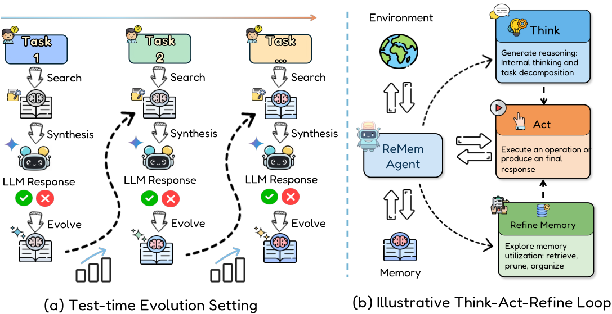

# Evo-Memory: Benchmarking LLM Agent Test-time Learning with Self-Evolving Memory

> University of Illinois Urbana-Champaign / Google DeepMind · 2025-11-25 · paper · **支撑·无闭环** · [论文](https://arxiv.org/abs/2511.20857)
> 机制族：记忆进化评测研究 · 来源核验 2026-09-17 · 复现状态 not-run

## Pipeline

流式基准而非机制：静态数据集重组为顺序任务流，每步走'检索-综合-进化'（从记忆检索、作答、以正确性信号更新记忆）。十个数据集覆盖单轮（MMLU-Pro、GPQA、AIME 24/25、ToolBench）与多轮（AlfWorld、BabyAI、ScienceWorld、PDDL）；对比 10+ 记忆模块（Mem0、A-MEM、MemOS、AWM、Dynamic Cheatsheet 等）并新增 ExpRAG 与 ReMem（动作-思考-记忆精炼）基线。

*图源：Figure 2*
## 结果（作者报告，非本地复现）

自进化记忆稳定有效，多轮场景增益最大（Claude 3.7 Sonnet：ReMem 平均成功率 0.78 对 History 0.49）；增益与数据集内任务相似度相关（Pearson r=0.717/0.563）；难->易迁移优于易->难（均值 0.94/0.97）；存失败经验让多个基线退化而 ReMem 稳健；简单 ExpRAG'胜过若干更复杂设计'；AlfWorld 步数从 22.6 降到 11.5。

## 证据边界

代码'接收后发布'（核验时未找到）；反馈信号仅正确性；基准测的是给定更新规则下的记忆，而非记忆与策略联合进化。

## 对 nanoRSI 的输入

对 nanoRSI：难->易优于易->难是实验设计规则——记忆流先难后易排课；'简单胜复杂'（ExpRAG）是加记忆机制前的反复警告。

## 来源

[arXiv abstract](https://arxiv.org/abs/2511.20857) · [Paper v2 (affiliations, Figure 2, results)](https://arxiv.org/html/2511.20857v2)
