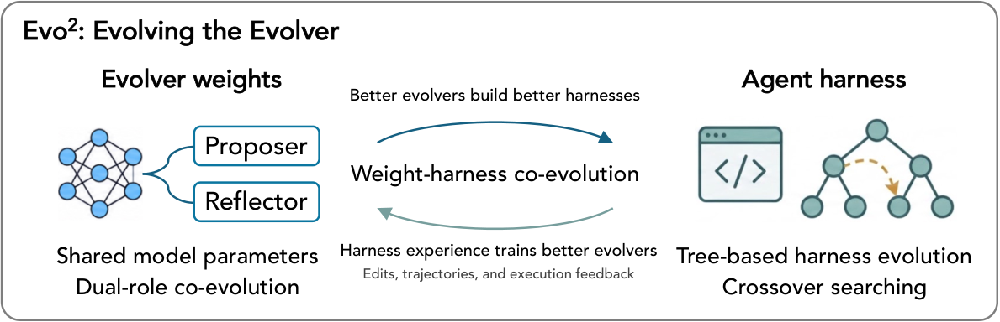

# Evo²: Evolving the Evolver through Weight-Harness Co-Evolution

> Google DeepMind / University of Illinois, Urbana-Champaign · 2026-10-09 · paper · **闭环** · [论文](https://arxiv.org/abs/2610.13025)
> 机制族：Harness 搜索与进化 · 来源核验 2026-10-14 · 复现状态 not-run

## Pipeline

单一策略在 harness 上扮演双角色：Proposer 写 harness 编辑、Reflector 诊断其效果并引导修订，交叉操作在搜索树分支间迁移策略。权重更新把闭环收到演化器自身：EvoTIDE（树引导交错双角色演化）用编辑抽取与前缀续写恢复可用训练轨迹，按每个角色决策引起的任务性能差给奖励（畸形输出记负奖励、只有留下机制确实运行的痕迹证据才计增益），再以 SFT 热启动加交错 GRPO 在 Proposer 与 Reflector 组间训练，每轮对位角色用冻结快照。

*图源：Figure 1 (fig1.png): weight-harness co-evolution overview with the shared Proposer-Reflector policy, harness edits and execution outcomes training the evolver weights, and crossover search*
## 结果（作者报告，非本地复现）

以 Qwen3.8-27B 同时充当执行器与演化器：Polyglot 82.1%、SWE-bench Verified 48.3%，对最强基线 62.6%（GEA）与 41.0%（HGM）；LiveCodeBench 58.0 对 56.0；演化出的 harness 无需再演化即跨基准迁移（6 个迁移方向中 5 个最佳，如 SWE 演化 harness 在 Polyglot 72.4）。在 60 题专有 SWE 子集上把 GPT-5-mini 从 24.4% 提到 48.3%、Claude Haiku 4.5 到 47.8%。记忆任务：LoCoMo F1 60.4 对 HGM 56.2；LongMemEval 71.5 对 64.4。训练演化器有效：训练对未训练消融 Polyglot +16.3（p=.001）、SWE +5.0（p=.086）、LoCoMo +9.3、LongMemEval +10.6；交叉再加约 4.1（Polyglot）；演化后 harness 调用更少（36 对 43）。

## 证据边界

SWE-bench 消融增益（+5.0）在 p<.05 下不显著（p=.086）；自演化主表只用一个开源执行器家族（Qwen3.8-27B）加专有子集；论文无显式局限章节；未发布代码或工件。

## 对 nanoRSI 的输入

双角色分解可映射到 nanoRSI 的提案器/闸门分工：一个策略既提编辑又反思闸门结果，按角色的性能差奖励可直接从既有冻结面板证据账本算出，无需新闸门行为。harness 对权重的交叉报告（以训练演化器消融为对照）正是 ADOPTION 第 38 项已要求的形态。

## 来源

[arXiv abstract](https://arxiv.org/abs/2610.13025) · [arXiv HTML v1](https://arxiv.org/html/2610.13025v1) · [arXiv PDF v1 (affiliations)](https://arxiv.org/pdf/2610.13025)
