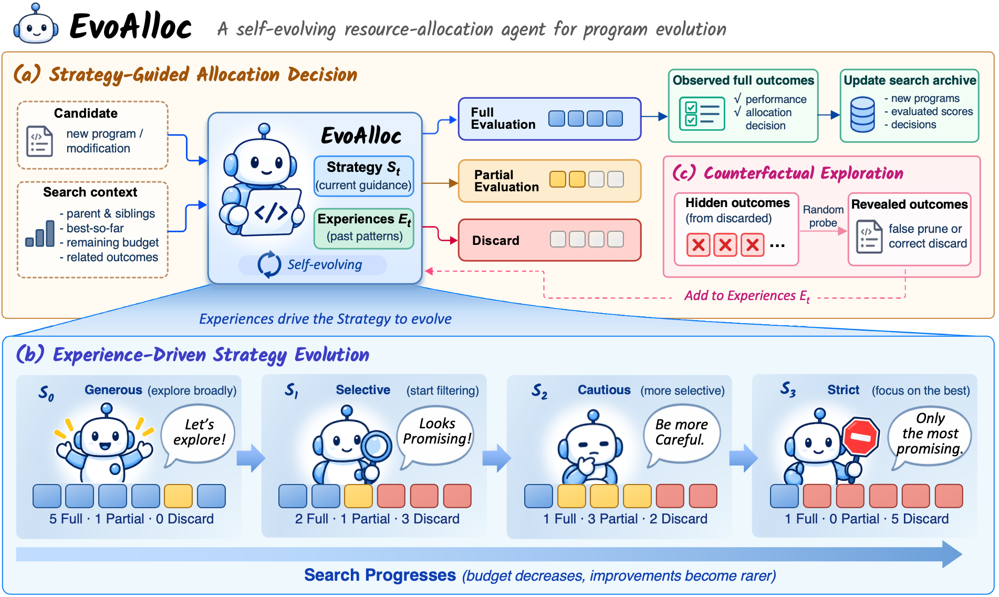

# EvoAlloc: A Self-Evolving Resource Allocation Agent for Efficient Program Evolution

> King Abdullah University of Science and Technology / Sakana AI · 2026-10-08 · paper · **支撑·无闭环** · [论文](https://arxiv.org/abs/2610.12086)
> 机制族：程序进化与进化搜索 · 来源核验 2026-10-11 · 复现状态 not-run

## Pipeline

EvoAlloc 学习在 LLM 程序演化中分配评测算力：一个分配智能体决定哪些候选获得完整评测，其策略通过把历史搜索与分配结果巩固为可复用经验来修订，并以反事实探索偶尔评测曾被拒绝资源的候选、揭示其结果以充实后续策略更新。被改变的对象是搜索循环内分配器的策略/经验状态，不是模型权重。

*图源：Figure 1 (figures/fig1.png): strategy-guided allocation, experience-driven strategy evolution and counterfactual exploration*
## 结果（作者报告，非本地复现）

作者报告的跨编码与智能体 harness 优化基准（附录含 ADAS-AIME 与 circle-packing 设置）结果：达到基线水平性能所需完整评测减少 59-82%、总 LLM token 减少 61-89%；在相同完整评测预算下，自适应分配取得 8.7-12.0% 更高的最终性能。以上为作者在其基准与预算下的报告，不是 nanoRSI 复现。

## 证据边界

该研究优化的是评测成本而非最终能力上限；核验的论文页面未发现公开代码、权重或数据发布，复现依赖作者材料。基准覆盖为作者的编码与 harness 套件，反事实探索率是论文分析了但 nanoRSI 未核验的敏感超参数。

## 对 nanoRSI 的输入

对 nanoRSI 有界评测预算的两个可移植方向：(1) 经验更新的分配器决定哪些候选提案进入完整面板评测，在匹配总 token 与评测次数下与固定轮转对照；(2) 把反事实探索用作误拦截量测——偶尔评测被选择器拒绝的提案，与既有的闸门反事实面板互相印证。两者均为可选择的实验设计，默认不改动任何调度器。

## 来源

[arXiv abstract](https://arxiv.org/abs/2610.12086) · [arXiv HTML v1 and Figure 1](https://arxiv.org/html/2610.12086v1)
