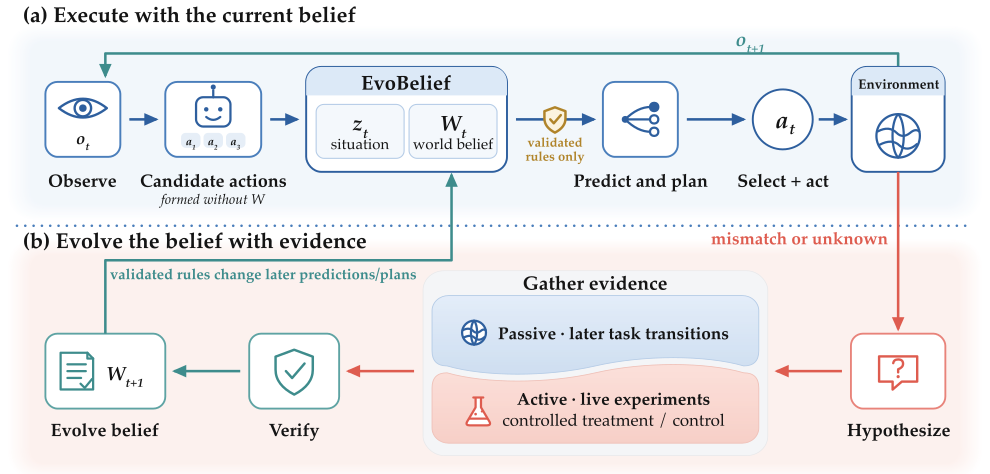

# EvoBelief: Falsifiable World Models for Self-Improving LLM Agents

> Tulane University / Amazon · 2026-10-08 · paper · **闭环** · [论文](https://arxiv.org/abs/2610.12789)
> 机制族：结构化知识库与图 · 来源核验 2026-10-14 · 复现状态 not-run

## Pipeline

LLM 全程冻结；自演化世界模型把环境知识编码为与证据挂钩的可证伪假设。预测失配或决策关键未知会开启证据环：从意外中形成假设，经后续观测与设计实验验证，反例收窄或废除规则；只有验证过的规则才引导之后的预测与规划，整个闭环无任何参数更新。承诺闸约束规则翻动。

*图源：Figure 2 (evobelief-workflow.svg): verified belief revision closing the loop from experience to later behavior*
## 结果（作者报告，非本地复现）

ALFWorld 无记忆设定对匹配的冻结世界模型：+23.9（Claude Haiku 4.5：66.42 对 42.54）、+31.3（GPT-5.4：76.12 对 44.78）；ScienceWorld 64.44/71.11。MiniGrid 第 20 集后静默换钥匙：EvoBelief 61.67→95.00（MG-C 族），冻结世界模型近 0-50%；留出种子 69.6% 对 1.3%；标签置换对照 80.8% 对 7.1%。DiscoveryWorld 反应器实验室（GPT-5.4）：Normal 档 83.3%、Challenge 档 58.3% 完成，所有被评基线（ReAct、WorldEvolver、Hypothesizer）均为 0%。消融：去掉实验或学到的规则成功率塌到约 0%；从未执行的影子规则 57.08%；去掉承诺闸是零效应（68.33 对 69.58）。

## 证据边界

纯文本环境；随机场景需用统计检验替代计数阈值；昂贵或不可逆的干预需要超出当前闸的风险限制；情景记忆与信念有重叠；承诺闸消融在确定性 MiniGrid 上为零效应；Plant Nutrients 上对最强基线的完成率差置信区间含零。

## 对 nanoRSI 的输入

反例触发的规则废除是 nanoRSI 技能库的廉价完整性清扫：每次冻结面板失败都应尝试证伪当时使用的技能，而不只蒸馏新技能；先验证后引导把 ADOPTION 第 46 项的回放验证准入从记忆编辑扩展到规则型技能。

## 来源

[arXiv abstract](https://arxiv.org/abs/2610.12789) · [arXiv HTML v1](https://arxiv.org/html/2610.12789v1)
