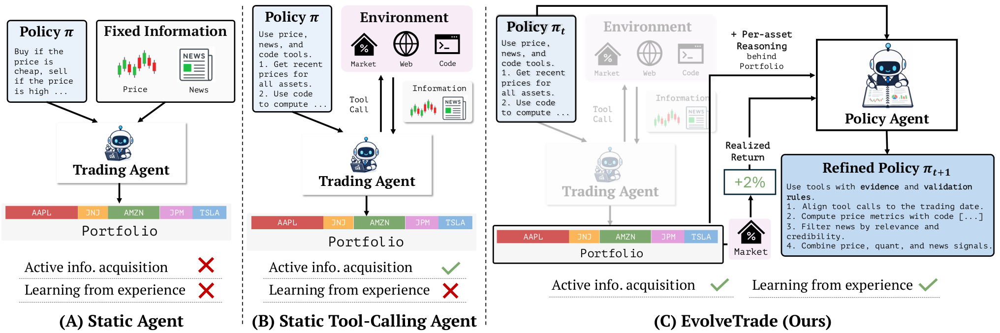

# EvolveTrade: Experience-Driven Policy Refinement for Self-Evolving LLM Trading Agents

> KAIST / DeepAuto.ai · 2026-09-15 · paper · **闭环** · [论文](https://arxiv.org/abs/2609.17632)
> 机制族：Harness 搜索与进化 · 来源核验 2026-09-19 · 复现状态 not-run

## Pipeline

交易 agent 的系统提示被当作文本参数化的工具调用策略：独立 Policy Agent 每五个交易日依据决策轨迹与组合实绩改写它，底座 LLM 与工具全程冻结。

*图源：Figure 1 (concept_evolvetrade.png)*
## 结果（作者报告，非本地复现）

GPT-5-mini、15 只美股蓝筹、3 次运行均值：Nov 2025 窗口 Sharpe 5.12 vs 静态工具调用 agent 2.87、累计收益 5.10% vs 3.30%；最强窗口 8.43/6.84%；Feb 2026 诚实负结果（Sharpe −2.53 vs 静态 −1.54）；50 交易日长窗含 10bps 手续费仍 SR 4.00 vs 2.94。

## 证据边界

作者自报的 15 标的三种子回测；三个窗口之一输给静态策略；Apr 2026 的 Gemini-2.5-Flash 底座上静态基座 agent 反超；未找到代码发布。

## 对 nanoRSI 的输入

一个带诚实负结果的最小自进化 agent 夹具：策略文本仅每 N 个任务批次依据累积轨迹证据改动，逐窗口对冻结策略的胜负就是发布口径。

## 来源

[arXiv abstract](https://arxiv.org/abs/2609.17632) · [Paper HTML (affiliations, Tables 3/4, Figure 1)](https://arxiv.org/html/2609.17632v1)
