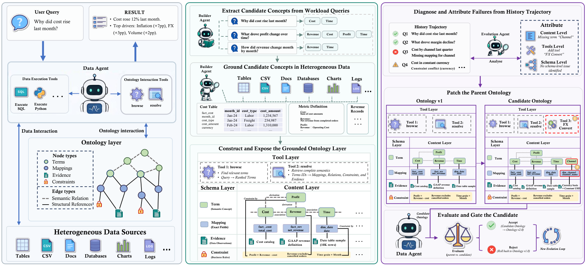

# EvoOntology: A Self-Evolving Ontology Layer for Data Agents

> Renmin University of China · 2026-09-14 · paper · **闭环** · [论文](https://arxiv.org/abs/2609.15779) · [仓库](https://github.com/ruc-datalab/EvoOntology)
> 机制族：结构化知识库与图 · 来源核验 2026-09-16 · 复现状态 not-run

## Pipeline

进化的对象是打包为 MCP 服务器的本体层（模式、内容、工具三层），位于数据智能体与异构数据源之间。构建智能体先从负载查询构建证据落地的初始本体；随后诊断-归因-补丁-闸门循环精炼它：轨迹失败经交互签名归因到唯一一层，类型化候选补丁只改该层，骨干条件化配对闸门只在同一骨干、同一验证集、相同解码与预算下提升至少 tau 时才接受候选；被拒绝的补丁留痕。

*图源：Figure 2*
## 结果（作者报告，非本地复现）

三个基准、四个分析骨干。DDR-Bench 轨迹级对 ReAct 基线：GPT-5.5 90.9（+26.7）、GPT-5.6-sol 93.5（+25.0）、Claude-Sonnet-5 81.3（+8.8）、Claude-Opus-4.8 92.3（+19.3）——平均 +17.8；对 ReAct+Memory 为 89.5 对 75.8（+13.7）。增益归因：构建器 +12.3，进化环再 +7.7（DDR-Bench）；BIRD EX 上 +5.1 再 +3.7。闸门消融损失 -11.2 轨迹级，归因 -6.3。诚实负结果：InsightBench 已饱和（均值 +0.7~+1.6），进化后本体跨骨干迁移至少掉 6.6 分。

## 证据边界

进化依赖特定骨干（配对闸门以同骨干为验收条件）；已饱和基准近零增益；配对验证带来额外算力，作者以总成本比基线低约 20% 对冲；无专门局限性章节。

## 对 nanoRSI 的输入

对 nanoRSI：把知识产物（技能库、领域笔记）当作带层级限制编辑的类型化对象，配同条件配对验收闸门与拒绝日志——与证据账本同构，应用于进化产物。

## 来源

[arXiv abstract](https://arxiv.org/abs/2609.15779) · [Paper v1 (affiliations, Figure 2, Tables, gate details)](https://arxiv.org/html/2609.15779v1) · [Code repository (MIT)](https://github.com/ruc-datalab/EvoOntology)
