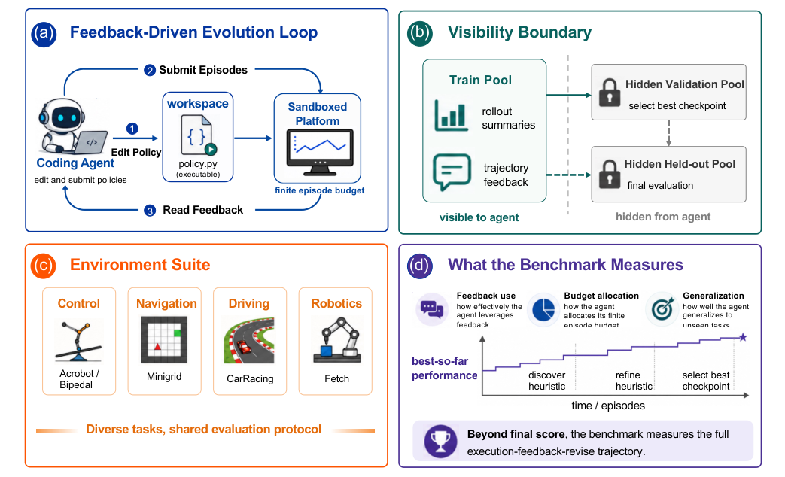

# EvoPolicyGym: Evaluating Autonomous Policy Evolution in Interactive Environments

> University of Science and Technology of China / The Chinese University of Hong Kong / University of Macau / Tsinghua University / Zhejiang University 等 · 2026-07-02 · paper · **支撑·无闭环** · [论文](https://arxiv.org/abs/2607.02440) · [仓库](https://github.com/Linzwcs/EvoPolicyGym)
> 机制族：程序进化与进化搜索 · 来源核验 2026-09-17 · 复现状态 not-run

## Pipeline

评测'策略即代码'进化的基准而非训练方法：固定 Gymnasium 风格环境（MiniGrid、Box2D、MuJoCo 族）；智能体在工作区反复编辑可执行 Python'策略系统'，提交训练 rollout（总计至多 128 回合）并获服务器中介反馈；用隐藏的验证选中检查点在留出回合上计分——训练反馈可见、验证/留出隐藏在服务端。诊断把编辑分为综合（新结构）与调参。

*图源：Figure 1*
## 结果（作者报告，非本地复现）

Core16 留出归一化回报：GPT-5.5（Codex）0.891、9 胜且 16 环境全进前二；Claude Opus 4.7（Claude Code）0.750；MiniMax-M3 0.531；DeepSeek-V4-Pro 0.359；随机 0.109。强智能体把综合编辑转化为新验证最优的比率达 41-48%，弱者仅 3-10%。进化出的机制含道路掩码前瞻（CarRacing）、周期步态（HalfCheetah）与 BFS 建图（ObstructedMaze）。

## 证据边界

诊断是'保守代理而非语义证明'（AST 拓扑忽略行为相似性）；策略源边界排除生成数据与学习权重；128 回合预算远低于标准 RL 样本量级，故排除常规 RL 基线；跨 harness 的 token 未归一。

## 对 nanoRSI 的输入

对 nanoRSI：现成的工件轨评分协议——服务端隐藏验证检查点 + 留出回合 + 硬回合预算，并在账本中区分综合与调参编辑。

## 来源

[arXiv abstract](https://arxiv.org/abs/2607.02440) · [Paper v1 (affiliations, Figure 1, Core16 table)](https://arxiv.org/html/2607.02440v1) · [Code repository (MIT)](https://github.com/Linzwcs/EvoPolicyGym)
