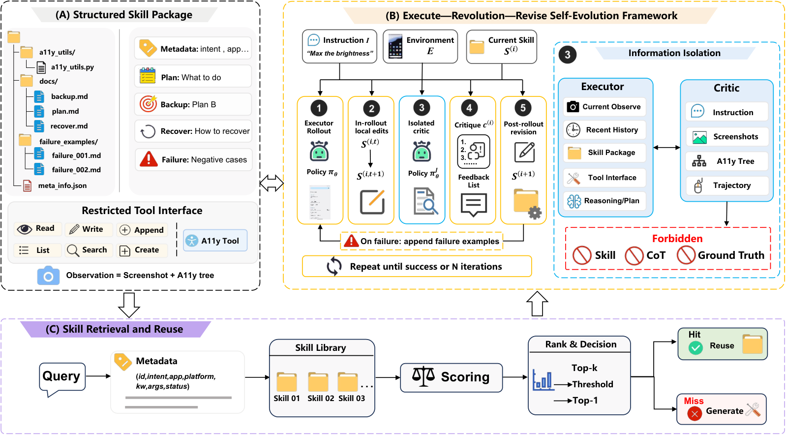

# Reflect, Revise, Reuse: Training-Free Skill Evolution for GUI Agents

> Zhejiang University / University of Electronic Science and Technology of China · 2026-09-15 · paper · **闭环** · [论文](https://arxiv.org/abs/2609.17653)
> 机制族：技能文件优化与技能库 · 来源核验 2026-09-18 · 复现状态 not-run

## Pipeline

技能是部署期持续修订的多文件包，走反思-修订-复用循环：隔离评审者诊断失败、受限编辑接口限定可改的技能文件、修订过闸后复用——全程无权重更新。

*图源：Method figure (method.png)*
## 结果（作者报告，非本地复现）

免训练增益最高 +16.2%（MobileWorld）、+6.0%（AndroidWorld）、+10.5%（OSWorld），最后一项是跨基准迁移设定。

## 证据边界

作者自报；仅 GUI 域；摘要未完整量化修订预算与评审者误差的影响。

## 对 nanoRSI 的输入

受限编辑接口（仅指定技能文件可写）加隔离评审者与 nanoRSI 的契约守卫同构；把部署期修订加为对照条件，可区分'技能变好了'与'技能没坏、执行漂移了'。

## 来源

[arXiv abstract](https://arxiv.org/abs/2609.17653) · [Paper HTML (affiliations, method figure)](https://arxiv.org/html/2609.17653v1)
