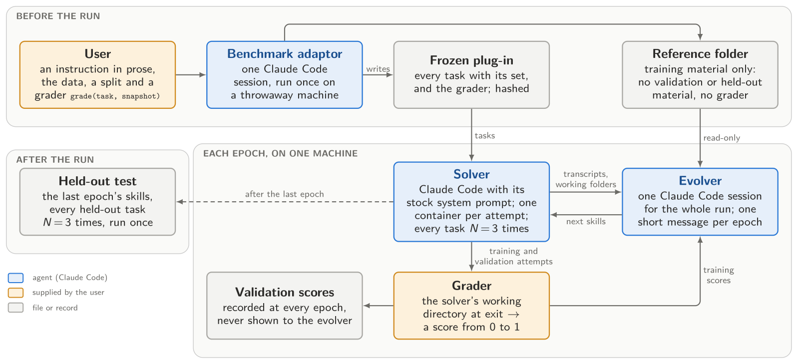

# EvoSkill v2: Fully Agentic Skill Evolution from Benchmark Adaptation to a Stateful Evolver

> Sentient Labs · 2026-10-20 · paper · **闭环** · [论文](https://arxiv.org/abs/2610.25931)
> 机制族：技能文件优化与技能库 · 来源核验 2026-10-21 · 复现状态 not-run

## Pipeline

只编辑指令文件的三智能体技能演化（模型与 harness 不动）。基准适配器把用户描述的基准与评分器冻结为插件；求解器每轮对全部训练/验证任务各尝试三次；演化器是一个带 bash 工具、跨整次运行持续存在的有状态编码智能体——区别于逐次调用的优化器（SkillOpt）与每轮重启的智能体（SkillBoost）。演化器测量求解器 rollout 的次间方差，每个训练任务给多次尝试，并接受每一轮的技能而不是在噪声分数上做选择。

*图源：Figure 1 (figArch.svg), arXiv HTML 2610.25931v1, rendered to PNG*
## 结果（作者报告，非本地复现）

在有细粒度标准答案的设定下，EvoSkill v2 的技能把留出通过率在 SpreadsheetBench v2 上超过 SkillOpt/SkillBoost 中较强者 7.7 点、tau3-bench banking 上 5.4 点；两个基准、两种反馈设定下，其演化器每提升一点留出通过率的成本都低于两个基线优化器；较弱模型自我改进技能在 tau3 上最多 +21.5 点。

## 证据边界

仅指令文件面；两个基准且评分器由用户提供；接受每轮以测量预算换选择稳健性（无逐轮过滤），留出对比独自承担全部检验；rollout 方差处理为启发式。

## 对 nanoRSI 的输入

给选择器研究（ADOPTION 38/53）两项协议输入：跨代携带记忆的有状态提案器会话（替代逐次无状态）；以及“接受每一轮”实验臂——同预算下用最终留出面板对比全部轮次产物与闸门选择，直接检验逐编辑闸门是否丢弃最优（对照 AtomSearch 的 67% 非最优祖先发现）。

## 来源

[arXiv abs 2610.25931](https://arxiv.org/abs/2610.25931) · [arXiv HTML v1](https://arxiv.org/html/2610.25931v1)
