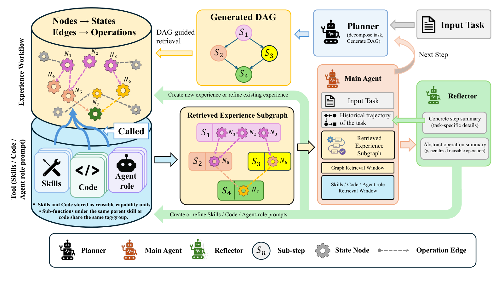

# EvoWeave: Composing Reusable Agent Experience through Operation Level Graphs

> New Jersey Institute of Technology / The Chinese University of Hong Kong · 2026-10-14 · paper · **闭环** · [论文](https://arxiv.org/abs/2610.19381)
> 机制族：结构化知识库与图 · 来源核验 2026-10-17 · 复现状态 not-run

## Pipeline

操作粒度的经验记忆：抽象状态为节点、可复用操作为有向边，边上带输入/输出契约、出处与能力引用。规划器把当前任务分解为依赖图；操作检索与有界定向搜索拼装相关经验片段；执行智能体可检查片段及其引用的能力；反思把具体执行证据与可复用抽象分离。

*图源：Figure 2 (method.png), arXiv HTML 2610.19381v1*
## 结果（作者报告，非本地复现）

覆盖四基准 × 五评测设置 × 三骨干。AppWorld Normal 与 Challenge 任务目标完成度均值 51.91 与 27.99，高出无记忆基线 6.99 与 4.99 个百分点；AppWorld 消融显示有向连接比独立操作卡片再高 2.08 分。论文同时给出检索开销与有效复用条件的权衡。

## 证据边界

未找到代码链接；主要增益是跨设置均值（逐骨干方差未重推）；基准覆盖窄于其所构建的记忆基准文献。

## 对 nanoRSI 的输入

给每个可复用操作加契约与出处，是 nanoRSI 技能文件的 schema 升级方向：每条技能携带类型化输入/输出契约与能力出处，让检索在花费一次 rollout 前先检查兼容性——只读的 schema 扩展，与现有技能面兼容。

## 来源

[arXiv abs 2610.19381](https://arxiv.org/abs/2610.19381) · [HTML full text v1](https://arxiv.org/html/2610.19381v1)
