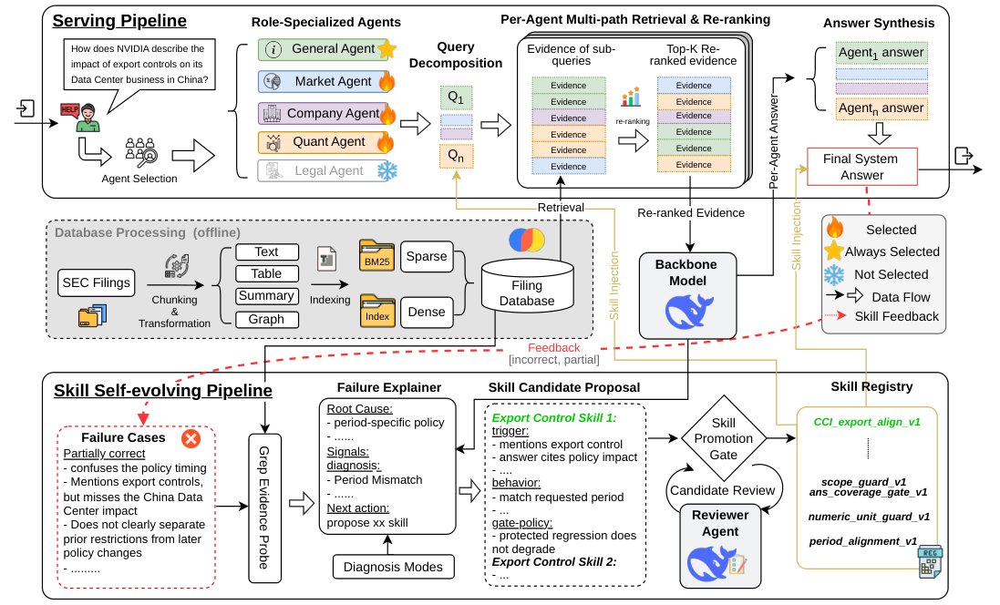

# FINSKILLOPS: A Self-Evolving Multi-Agent System for SEC Filing QA

> SimpleWay.AI / McGill University / University of Toronto / UCLA / The Chinese University of Hong Kong 等 · 2026-09-17 · paper · **闭环** · [论文](https://arxiv.org/abs/2609.19680)
> 机制族：技能文件优化与技能库 · 来源核验 2026-09-19 · 复现状态 not-run

## Pipeline

类型化、证据接地的失败诊断被转成带作用域的技能补丁，经定向验证、回归检查与阴性对照后，在 SEC 文件问答的服务/进化双环中做版本化替换或退役。

*图源：Figure 1 (emnlp-FinEvo-Final.png)*
## 结果（作者报告，非本地复现）

进化技能把裁判打分的正确性从 3.70 提到 4.55；另一项 12 轮运营研究仅晋升 33 个提案技能中的 6 个，监控非正确率从 20.0% 降至 12.5%。

## 证据边界

作者自报于自建金融问答场景、评分依赖 LLM 裁判；6/33 晋升率是诚实的头条——多数提案技能未过闸；未找到代码发布。

## 对 nanoRSI 的输入

阴性对照准入（提案技能必须在失败切片上胜过不作为对照）与显式退役是 nanoRSI 技能流缺的两道闸；6/33 晋升率是现实的前置参考。

## 来源

[arXiv abstract](https://arxiv.org/abs/2609.19680) · [Paper HTML (affiliations, Figure 1, abstract numbers)](https://arxiv.org/html/2609.19680v1)
