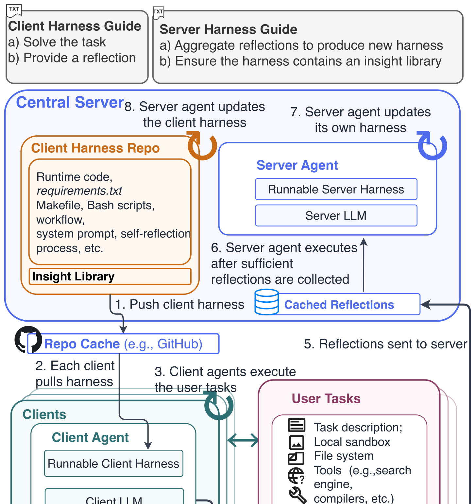

# Federation over Harness

> University of Chicago · 2026-10-20 · paper · **闭环** · [论文](https://arxiv.org/abs/2610.24007) · [仓库](https://github.com/dixiyao/FoH)
> 机制族：Harness 搜索与进化 · 来源核验 2026-10-21 · 复现状态 not-run

## Pipeline

在分布式多智能体经验共享中同时自动演化两个层级的 harness。服务端智能体演化各客户端的任务求解与自我反思 harness，同时演化自己用于聚合分布式反思、维护共享洞察库、更新后续客户端 harness 的 harness。关键在于 FoH 不需要任何额外验证信号——无标准答案、无验证数据——仅从分布式智能体自生成的反思中学习。

*图源：Figure 1 (workflow.svg), arXiv HTML 2610.24007v1, rendered to PNG*
## 结果（作者报告，非本地复现）

在 PinchBench（V1 既有任务 + 124 个仅 V2 的留出任务）与 ClawEval 上，FoH 较固定 harness 的单智能体基线提升 53.57%，较单智能体 harness 自演化提升 29.76%；ScienceAgentBench 上孤立智能体失败而 FoH 演化的客户端 harness 用同一 LLM 解出，且各任务技能激活模式各异；消融显示剔除洞察库或本地反思后不稳定。

## 证据边界

仅反思反馈：无任何环节验证沉淀洞察的正确性，增益取决于反思质量（论文自身表述）；以日常智能体基准为主；分解显示服务端 harness 更新占掉几乎全部输出 token。

## 对 nanoRSI 的输入

无验证信号设定是对本仓库“评测器冻结”教义的诚实压力测试：任何仅反思的变体都必须标注为设计上不可验证、并与冻结评测器闸门对照；其客户端/服务端双编辑面也恰映射到每工作区技能文件与种群级共享文件。

## 来源

[arXiv abs 2610.24007](https://arxiv.org/abs/2610.24007) · [arXiv HTML v1](https://arxiv.org/html/2610.24007v1) · [dixiyao/FoH (MIT)](https://github.com/dixiyao/FoH) · [FoH LICENSE (MIT)](https://raw.githubusercontent.com/dixiyao/FoH/main/LICENSE)
