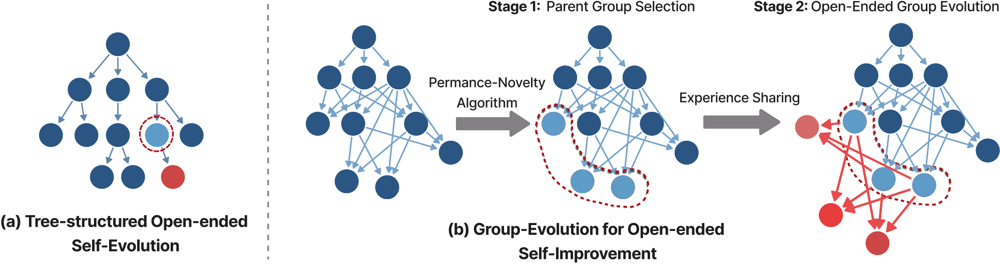

# Group-Evolving Agents: Open-Ended Self-Improvement via Experience Sharing

> University of California, Santa Barbara · 2026-02-04 · paper · **闭环** · [论文](https://arxiv.org/abs/2602.04837)
> 机制族：自改写元智能体与谱系 · 来源核验 2026-10-15 · 复现状态 not-run

## Pipeline

把整个 agent 群体而非单一谱系作为进化单元：自改进 agent 自主改写自身架构，群内成员在开放式演化中共享复用经验，使早期探索多样性得以保留而非损失在孤立的树分支里。最佳 agent 整合来自多个不同祖先的经验。

*图源：Figure 1 (pipeline_overall.png): GEA vs tree-structured self-evolution - isolated branches on the left, group-level experience sharing on the right*
## 结果（作者报告，非本地复现）

SWE-bench Verified 71.0% 对最强自演化基线 DGM 56.7%；Polyglot 88.3% 对 68.3%。对顶级人工设计框架：OpenHands+GPT-5 71.8%、Aider+GPT-5(high) 52.0%——匹配或超越。鲁棒性：框架级 bug 平均 1.4 次迭代修复（对照 5.0）；最佳 GEA agent 整合 17 个不同祖先（DGM 为 9）；改进跨 GPT 系与 Claude 系骨干迁移。

## 证据边界

未发布代码；arXiv 页与论文正文均无仓库链接。71.0/88.3 是论文自身 harness 设置下对自演化基线的数字；人工框架对比使用不同骨干（GPT-5）。

## 对 nanoRSI 的输入

群体级经验共享是对 nanoRSI rejected_recent 隔离的反向设计：失败候选的诊断轨迹可以共享给后续提案而非只做压制；17 祖先广度也是 ADOPTION 第 39 项可直接计算的选型统计（幸存候选动用了多少个不同先前尝试）。

## 来源

[arXiv abstract](https://arxiv.org/abs/2602.04837) · [arXiv HTML v1](https://arxiv.org/html/2602.04837v1)
