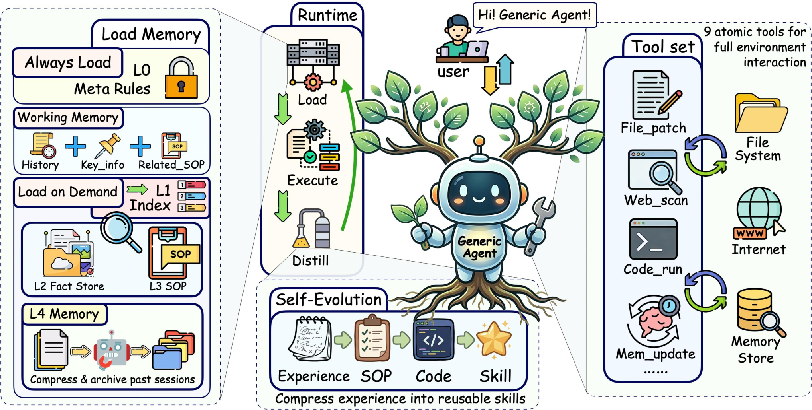

# GenericAgent: A Token-Efficient Self-Evolving LLM Agent via Contextual Information Density Maximization (V1.0)

> Advantage AI Agent Lab (Shenzhen Aquaintelling Technology + Fudan University) · 2026-04 · paper · **闭环** · [论文](https://arxiv.org/abs/2604.17091) · [仓库](https://github.com/lsdefine/GenericAgent)
> 机制族：Harness 搜索与进化 · 来源核验 2026-09-21 · 复现状态 not-run

## Pipeline

统一智能体循环（约 3,300 行代码中核心约 92 行，比 OpenClaw 小 160 倍以上）从任务、记忆与两层技能树（类别 + 带使用计数的命名技能）构造执行上下文。课程规划器为技能候选打分（收益/难度/使用/兴趣，权重 0.3/0.2/0.3/0.2）并经反思自适应权重；每个任务以'技能固化'收尾——归档 Markdown 报告、更新技能树、递增计数——部署产物单调增长而循环保持极小。

*图源：Figure 2*
## 结果（作者报告，非本地复现）

Lifelong AgentBench：222K 输入 token 下 100% 准确率，对 OpenClaw 1.43M 下 70%、Claude Code 800K 下 75%（约 6.4 倍 token 优势——即仓库的'6 倍'说法）。长时程任务 188.8K token 下 100%，对 Claude Code 537K。自进化第 1 -> 9 轮：222,203 -> 23,010 token（-89.6%）、7m30s -> 1m38s、32 -> 5 次 LLM 调用。20 个技能后提示仅 2,298 token，对 Claude Code 22,821、OpenClaw 43,321。跨任务节省 61.0-92.4%（总体 79.3%）。

## 证据边界

30 轮上下文上限迫使长研究跨会话；自适应权重缺乏长期验证；自改进日志人工整理；技能树的合并/废弃靠手工。

## 对 nanoRSI 的输入

对 nanoRSI：证明带技能固化的极小种子环能在 token 效率上胜过百万行级 harness——nanoRSI 的纯标准库内核押注相同；使用计数与按技能隔离提示是最廉价的第一步。

## 来源

[arXiv abstract](https://arxiv.org/abs/2604.17091) · [Paper v1 (Figure 2, token/cost tables)](https://arxiv.org/html/2604.17091v1) · [Code repository (MIT)](https://github.com/lsdefine/GenericAgent)
