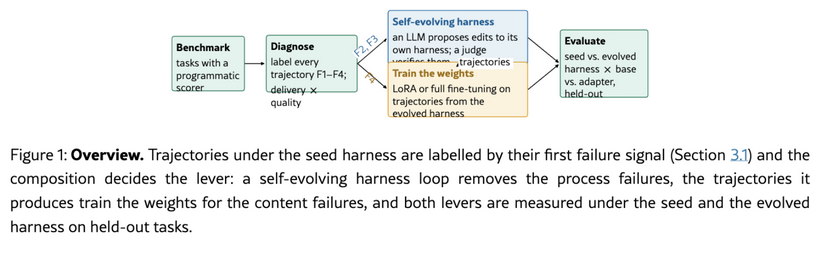

# Harness Evolution Hits a Ceiling: When Weight Training Should Begin

> Independent / University of California, Berkeley / Purdue University / Stanford University · 2026-10-08 · paper · **闭环** · [论文](https://arxiv.org/abs/2610.11655)
> 机制族：Harness 搜索与进化 · 来源核验 2026-10-13 · 复现状态 not-run

## Pipeline

种子 harness 下的轨迹按首个失败信号标注为失败构成；过程性失败（调用受阻、循环、预算耗尽）分流给自演化 harness 循环（LLM 提议编辑、judge 校验），内容性失败分流给权重训练：在演化后 harness 采集的轨迹上做 LoRA 或全量微调。两个杠杆用交叉设计（种子/演化 harness x 基座/适配器权重）在保留任务上评估，并以逐轮全新锚点取代自报分数。

*图源：Figure 1 (inline TikZ in the arXiv HTML; captured as a browser screenshot of the rendered figure element because the source stores it as an SVG fragment with foreignObject text)*
## 结果（作者报告，非本地复现）

在 DeepPlanning（48 开发 / 72 保留）上，harness 演化把 Qwen3.5-4B 保留分从 0.16 提到 0.30、Qwen3.5-9B 从 0.32 提到 0.44（对全新锚点的四轮均值）；在演化后 harness 轨迹上训练的 LoRA 适配器在种子 harness 上再加 +0.13（两个尺寸均是），9B 适配器把内容性失败份额从约 25-28% 压到约 5%。答案乱序数据上的安慰剂适配器低于基座。该循环迁移到 WebArena-Lite（117 个未见任务 +0.088，0.256->0.344），适配器在该域无增益。横跨六家族八个模型，harness 杠杆在其中三个较小模型上无收益；作者另报前沿模型读数（GLM 5.3 开发 0.512 / 保留 0.488，无对照）。

## 证据边界

诊断需要轨迹级过程信号加任务级评分器；部分消融格子只用两轮 rollout；安慰剂对照仅存在于 9B 模型；未与同预算的测试时搜索基线比较；基准的 LLM 计划转 JSON 环节使审计答案上的分数虚高约 0.025；两处比较跨夜、少数早期线重测过；前沿模型运行缺逐次数据与噪声估计。

## 对 nanoRSI 的输入

先诊断后干预的规则可在 nanoRSI 直接检验：把每次失败标注为过程性或内容性，只把过程性失败路由给 harness/技能编辑，并报告过闸集合的构成是否相对全失败选择器改变。交叉评估（harness 状态 x 权重状态）与全新锚点复测正是条目 38-39 已要求的报告形态。

## 来源

[arXiv abstract](https://arxiv.org/abs/2610.11655) · [arXiv HTML v1](https://arxiv.org/html/2610.11655v1)
